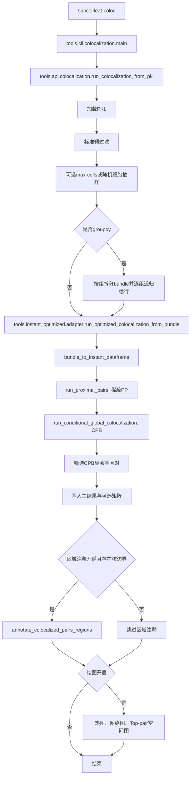
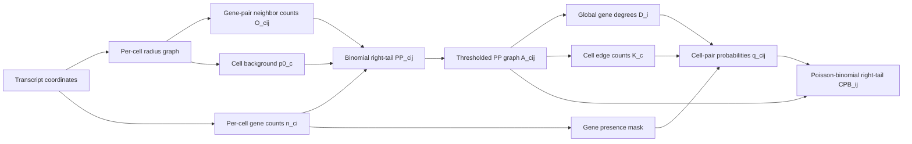

# 共定位检测模块计算原理与实现详解

> 文档版本：2026-07-24
> 对应工具：`subcellular-feature-toolbox 0.1.0`
> 正式命令入口：`subcellfeat-coloc`
> 当前可用独立重绘入口：`python -m tools.cli.coloc_plot`
> 跨组/跨数据集汇总入口：`python -m tools.cli.coloc_summary`
> 主要实现：`tools/cli/colocalization.py`、`tools/api/colocalization.py`、`tools/instant_optimized/`、`tools/engines/coloc_region_annotation.py`、`tools/engines/coloc_visualization.py`

---

## 1. 文档目的

本文描述当前仓库中**实际运行的完整共定位功能**，重点回答以下问题：

1. 标准PKL中的每条转录本如何进入共定位计算；
2. 预过滤依次删除什么、保留什么；
3. 细胞级PP检验的零假设、观测量、试验次数和p值如何计算；
4. 全局CPB检验如何把多个细胞的PP结果合并；
5. 优化版为何不保存完整`cell × gene × gene`张量，但仍保持统计定义；
6. `distance`、`pp_alpha`、`cpb_alpha`和`min_genecount`分别作用在哪一层；
7. 细胞抽样、分层抽样和`groupby`如何改变分析作用域；
8. 区域注释如何把显著基因对分为`nuclear`、`perinuclear`、`cytosolic`和`peripheral`；
9. 为什么区域主导标签不是简单选择原始点数最多的区域；
10. 热图、网络图和Top-pair空间图分别展示什么，不能解释什么；
11. 每一个命令行参数、Python参数、输出文件和关键内部方法的实际作用；
12. 当前实现的性能优化、恢复机制、已知限制和容易误用的边界。
13. 从机器学习和统计计算视角理解随机变量、充分统计量、算法复杂度、数值稳定性、超参数敏感性与模型校准边界。

本文以当前源码为最高依据。历史README、旧日志或上游InSTAnT代码与当前执行路径不一致时，以本文列出的当前调用链和代码行为为准。

---

## 2. 一句话理解共定位模块

当前共定位模块执行两个层级的统计检验，再执行一个可选的区域后处理：

> 首先在每个细胞内部检验两个基因的转录本是否比随机情况更容易出现在距离`d`以内，得到细胞级PP p值；随后跨细胞评估“出现显著PP关系的细胞数”是否超过全局网络背景期望，得到CPB p值；最后只对CPB显著基因对统计近邻转录本端点在四类亚细胞区域中的面积归一化富集。

因此，模块输出的三个核心概念必须分开理解：

| 层级 | 核心问题 | 主要结果 |
|---|---|---|
| PP | 在单个细胞中，基因A与基因B是否异常接近 | 每个细胞、每个基因对的PP p值 |
| CPB | 在全体细胞中，显著PP关系是否出现得异常频繁 | 每个基因对的全局CPB p值 |
| Region | 已经显著的近邻关系主要富集在哪个区域 | 四区域enrichment及`dominant_region` |

区域注释是PP/CPB完成后的后处理，不会反过来改变PP或CPB结果。

---

## 3. 当前正式调用链



### 3.1 当前正式统计核心

正式命令虽然名称仍为InSTAnT共定位，但PP/CPB实际执行的是：

```text
tools/instant_optimized/adapter.py
tools/instant_optimized/core.py
```

它不再调用上游原版的完整稠密PP张量实现，而是使用统计等价的稀疏实现。

### 3.2 保留但不属于正式主路径的实现

| 模块 | 当前定位 |
|---|---|
| `tools/engines/instant_adapter.py` | 原版InSTAnT适配器、输入转换和显著表公共函数；正式路径仍复用其中部分帮助函数 |
| `tools/instant_core/InSTAnT.py` | 内置上游/旧版统计实现，主要作为兼容与差分验证参考 |
| `tools/instant_optimized/api.py` | 优化版的独立API镜像，用于测试和独立运行；正式控制台入口仍走`tools/api/colocalization.py` |
| `tools/instant_optimized/cli.py` | 独立优化版CLI入口，不是`pyproject.toml`当前正式控制台命令 |

### 3.3 各模块职责

| 文件 | 主要职责 |
|---|---|
| `tools/cli/colocalization.py` | 定义主命令全部参数并转发给API |
| `tools/api/colocalization.py` | 加载、清理旧输出、预过滤、抽样、分组、调用统计核心、区域注释、绘图和输出编排 |
| `tools/api/compute_all.py` | 共享的核质比、cell-gene、gene支持度过滤及边界同步 |
| `tools/engines/instant_adapter.py` | PKL到InSTAnT表的字段转换；构建显著基因对表 |
| `tools/instant_optimized/adapter.py` | 串联稀疏PP、CPB并组装与旧API兼容的结果字典 |
| `tools/instant_optimized/core.py` | PP、CPB、Poisson-binomial、稀疏结果容器和多进程核心 |
| `tools/engines/coloc_region_annotation.py` | 四区域几何、近邻端点区域计分、面积期望、富集和检查点恢复 |
| `tools/instant_optimized/visualization.py` | 在不展开完整PP张量的情况下复用绘图模块 |
| `tools/engines/coloc_visualization.py` | 全pair表、CPB热图、网络图和Top-pair空间图 |
| `tools/api/coloc_plotting.py` | 从已有结果目录重画，不重跑PP/CPB/区域注释 |
| `tools/cli/coloc_plot.py` | 当前可用的独立重绘CLI实现 |
| `tools/engines/run_region_annotation_only.py` | 只运行区域注释，支持检查点和线程/进程执行器 |
| `tools/api/coloc_summary.py` | 汇总组内、跨组和跨数据集结果 |
| `tools/cli/coloc_summary.py` | 汇总模块CLI |

---

## 4. 依赖与运行环境

### 4.1 `pyproject.toml`声明的相关依赖

| 库 | 用途 |
|---|---|
| NumPy | 编码、计数、矩阵、稀疏索引、memmap和数值运算 |
| Pandas | 输入表、过滤、分组和CSV输出 |
| SciPy | `cKDTree`近邻搜索、二项分布、FFT卷积 |
| Shapely | 边界修复、区域几何、点到边界距离 |
| NetworkX | 基因共定位网络 |
| Matplotlib | 热图、网络图、空间图 |

### 4.2 代码中实际还使用的依赖

| 依赖 | 用途 | 状态 |
|---|---|---|
| `tools.instant_core.poibin.PoiBin` | 中等trial数量的精确Poisson-binomial尾概率 | 仓库内置 |
| Graphviz + pydot | 网络图`sfdp`布局 | 可选；缺失时自动回退NetworkX |

### 4.3 Matplotlib缓存

如果用户目录不可写，Matplotlib会临时在`/tmp/matplotlib-*`创建缓存。这不改变结果，但会增加首次导入时间。可显式设置：

```bash
export MPLCONFIGDIR=/tmp/matplotlib-cache
mkdir -p "$MPLCONFIGDIR"
```

---

## 5. 输入PKL结构

### 5.1 顶层对象

PKL反序列化后应为字典，常用键如下：

| 键 | 必需性 | 用途 |
|---|---|---|
| `data_df` | 必需 | 转录本坐标、基因和细胞ID |
| `cell_boundary` | 预过滤/区域/绘图需要 | 每个细胞的边界 |
| `nuclear_boundary` | 核质比/区域需要 | 每个细胞的核边界 |
| `coordinates` | 可选 | 当`groupby`或抽样分层字段不在`data_df`时，按`cell`补充元数据 |

### 5.2 `data_df`默认必需字段

| 字段 | 默认含义 | 转换后字段 |
|---|---|---|
| `cell` | 细胞ID | `uID` |
| `gene` | 基因名 | `gene` |
| `x` | X坐标 | `absX` |
| `y` | Y坐标 | `absY` |
| `z` | Z坐标；默认3D模式必需 | `absZ` |

转换函数会：

1. 复制`data_df`；
2. 将`cell`和`gene`强制转为字符串；
3. 将坐标强制转为浮点数；
4. 在3D模式下要求`z`存在，否则抛出`ValueError`；
5. 不自动删除坐标NaN，因此输入数据应在上游保证坐标有效。

### 5.3 边界格式

边界字典的键应能与字符串化后的细胞ID匹配。值可为：

- Shapely Polygon/MultiPolygon；
- 至少三行、至少两列的坐标数组；
- 包含`x`、`y`列的DataFrame。

几何修复顺序：

1. 空对象直接丢弃；
2. 尝试`make_valid`；
3. 失败时尝试`buffer(0)`；
4. GeometryCollection只保留polygon部分；
5. MultiPolygon在区域模块中保留最大有效polygon；
6. 面积小于等于0的对象丢弃；
7. 核边界与细胞边界求交，使核尽可能位于细胞内部。

### 5.4 `coordinates`的补充逻辑

当`--groupby celltype`或`--sample-stratify-by fov`指定的字段不在`data_df`时：

1. 检查`coordinates`是否为DataFrame；
2. 要求`coordinates`和`data_df`均有`cell`；
3. 对`coordinates[[cell, target_column]]`按细胞去重；
4. 将细胞ID转为字符串；
5. 左连接到`data_df`或构建细胞元数据表；
6. 缺失注释的细胞在`groupby`时不会进入任何非空组。

---

## 6. 输出目录清理规则

每次非分组运行开始时，API会删除可能由旧运行遗留的可选文件：

```text
instant_gene_list.csv
instant_input_after_prefilter.csv
instant_all_pairs.csv
instant_cpb_pvals.npy
instant_expected_coloc.npy
instant_gene_counts.npy
instant_pp_pvals.npy
prefilter_nc_ratio_cells.csv
prefilter_cellgene_counts.csv
prefilter_gene_support.csv
instant_region_annotated_pairs.csv
cell_sampling_summary.csv
sampled_cells.txt
viz_*.png
```

注意：清理列表只匹配`viz_*.png`，不会自动删除同名PDF/SVG。因此在解释目录时应检查文件时间和运行参数，不能只依据文件是否存在判断本轮是否生成。

---

## 7. 完整计算流程

## 7.1 第一步：加载PKL

`pickle.load`会一次性反序列化整个bundle。当前主流程没有流式PKL读取，因此峰值内存至少包含完整输入bundle。

## 7.2 第二步：标准预过滤

默认开启，执行顺序固定：

```text
核质比极端值过滤
    ↓
cell-gene最小转录本数过滤
    ↓
gene最小细胞支持数过滤
    ↓
data_df / cell_boundary / nuclear_boundary共同细胞同步
```

### 7.2.1 核质比计算

对同时具有细胞和核边界的细胞：

```text
nc_ratio = nuclear_area / cell_area
```

只保留有限且满足：

```text
0 < nc_ratio < 1
```

然后计算`q_low`与`q_high`分位点，并保留闭区间内的细胞：

```text
quantile(q_low) <= nc_ratio <= quantile(q_high)
```

默认分位数为`0.025`和`0.975`。

保护规则：如果过滤后少于10个细胞，则整个核质比过滤跳过，保留过滤前bundle。

`nc_ratio_mean_low=0.4`和`nc_ratio_mean_high=0.6`当前**只用于报告**：

- 均值在范围内：`PASS`；
- 不在范围内：`WARN_NOT_FORCED`；
- 不会为了强行把均值拉回0.4–0.6继续删细胞。

如果没有核边界或没有有效比例，核质比过滤会跳过，而不是报错终止。

### 7.2.2 cell-gene转录本阈值

对每个`(cell, gene)`组合计数：

```text
n_transcripts(cell, gene)
```

默认保留：

```text
n_transcripts >= 6
```

这是局部删除：某基因在某个细胞低于阈值时，只删除该cell-gene组合的转录本，不必删除整个细胞，也不必立即删除该基因在其他细胞中的记录。

### 7.2.3 gene支持细胞数阈值

在cell-gene过滤之后重新统计：

```text
n_unique_cells(gene)
```

默认保留：

```text
n_unique_cells >= 10
```

未达到阈值的基因从所有细胞中删除。

### 7.2.4 边界同步

预过滤结束后取三者共同细胞：

```text
data_df cells ∩ cell_boundary keys ∩ nuclear_boundary keys
```

然后同步裁剪转录本表和两个边界字典。没有边界的数据集可能走共享函数中的相应兼容分支，但区域注释最终仍要求有效细胞与核边界。

## 7.3 第三步：调试性`max_cells`

如果设置`--max-cells N`：

- 使用过滤后`data_df["cell"].unique()`的前N个细胞；
- 不是随机抽样；
- 同步裁剪转录本和边界；
- 主要用于smoke test，不适合无偏统计抽样。

## 7.4 第四步：随机细胞抽样

抽样发生在PP/CPB之前，只改变输入细胞集合，不改变被选中细胞内部的统计公式。

### 7.4.1 固定数量抽样

```text
--sample-cells N
```

- N必须大于0；
- N超过总细胞数时截断为总细胞数；
- 无放回抽样。

### 7.4.2 比例抽样

```text
--sample-cell-frac F
```

- 要求`0 < F <= 1`；
- 目标数为`round(total_cells × F)`；
- 最少1个，最多总细胞数。

两种参数不能同时使用。

### 7.4.3 随机种子

使用：

```python
numpy.random.default_rng(sample_random_state)
```

默认种子为42。

### 7.4.4 分层抽样

如果指定`--sample-stratify-by`：

1. 按细胞获得分层标签；
2. 按各层细胞数比例计算原始配额；
3. 对配额向下取整；
4. 当总目标数不少于非空层数时，尽量每层至少抽1个；
5. 不允许配额超过该层细胞数；
6. 按小数余数从大到小补齐，直到总数精确达到目标；
7. 若“每层至少1个”导致超额，从当前配额最大的层开始删除。

抽样后输出：

- `cell_sampling_summary.csv`；
- `sampled_cells.txt`。

## 7.5 第五步：按组独立运行

`--groupby`会使每个组独立进行PP、CPB、区域注释和绘图。

### 7.5.1 组来源

分组字段可在：

- `data_df`；
- `coordinates`，按`cell`合并。

### 7.5.2 每个细胞与组的关系

代码对`[cell, groupby]`去重后分组。如果同一细胞被赋予多个不同组，它可能进入多个组；输入数据应保证每个细胞的分组唯一。

### 7.5.3 组目录安全化

非字母数字、下划线、点和连字符字符替换为下划线。不同原始组名如果映射为同一个安全目录名，独立优化API会拒绝运行；主API的早期实现需额外注意目录碰撞风险。

### 7.5.4 组内运行

主API当前会：

1. 先在全bundle上完成预过滤和可选抽样；
2. 按组取得细胞集合；
3. 为每组生成临时`_tmp_group_bundle.pkl`；
4. 递归调用单bundle流程，并设置`do_prefilter=False`，避免重复过滤；
5. 成功或失败后尝试删除临时PKL；
6. 输出`groupby_<column>_summary.csv`。

如果长任务中断，临时组PKL可能被保留，可用于直接恢复单组运行。

### 7.5.5 `--groups`

只保留指定的原始组值。不存在的组只打印warning，不会自动猜测近似名称。

### 7.5.6 `--skip-existing`

当组目录内存在`instant_significant_pairs.csv`时，该组标记为`skipped_existing`。

重要限制：该判断只检查主显著表是否存在，不检查：

- 行数是否完整；
- 区域注释是否存在；
- 图片是否完整；
- 矩阵是否存在；
- 文件是否来自相同参数。

因此恢复运行前应结合输出完整性检查，而不是盲目依赖文件存在。

---

## 8. InSTAnT输入表构建

转换后的表字段为：

```text
gene, absX, absY, uID
```

3D模式额外包含：

```text
absZ
```

PP核心随后进行：

1. 基因名排序并编码为`int32`；
2. 细胞ID排序并编码为`int32`；
3. 按细胞编码稳定排序所有转录本；
4. 计算每个细胞在连续数组中的`cell_offsets`；
5. worker只接收细胞索引，通过offset直接切片。

此设计避免原版在每个细胞上扫描全体转录本寻找所属行。

---

## 9. PP：细胞级近邻基因对检验

## 9.1 分析单位

PP的分析单位是：

```text
一个细胞 + 一个基因对
```

每个细胞独立建立KDTree和零模型。

## 9.2 细胞是否进入PP

设细胞总转录本数为`N_c`。只有满足：

```text
N_c > min_genecount
```

时才计算。默认`min_genecount=20`，因此：

- 20条转录本：跳过；
- 21条转录本：进入计算。

跳过细胞的gene count返回全0，PP语义为所有基因对p值等于1。

## 9.3 维度

- 默认：3D欧氏距离，使用`absX, absY, absZ`；
- `--use-2d`：2D欧氏距离，只使用`absX, absY`。

当前优化核心使用一个`cKDTree`直接在所选维度中计算距离。

## 9.4 活跃基因与基因对

只处理该细胞内实际出现的基因。设活跃基因数为`G_c`，生成含对角线的上三角：

```text
G_c × (G_c + 1) / 2
```

因此包括同基因对`gene_i-gene_i`的内部PP值。最终显著pair表只遍历`i < j`，不会输出同基因pair。

## 9.5 近邻转录本对

```python
cKDTree(coordinates).query_pairs(distance_threshold)
```

返回细胞内所有不同转录本行的无序近邻对，判定条件由SciPy的球查询定义，即距离不超过阈值。

设近邻转录本对总数为：

```text
E_c
```

## 9.6 PP零模型的近邻概率

细胞内不同转录本无序组合总数为：

```text
C(N_c, 2) = N_c × (N_c - 1) / 2
```

当前代码写成等价形式：

```text
p0_c = 2 × E_c / [N_c × (N_c - 1)]
```

如果该细胞没有任何近邻对，代码令：

```text
p0_c = 1
```

这是继承的实现语义，而不是通常直觉中的0。此时观测近邻数也是0，二项右尾通常得到1。

## 9.7 基因对试验次数

设基因i和j在该细胞的转录本数为`n_ci`和`n_cj`：

```text
T_cij = n_ci × n_cj
```

同基因对角线仍使用：

```text
T_cii = n_ci²
```

而不是`C(n_ci, 2)`。这是当前实现为保持既有InSTAnT定义而保留的行为。

## 9.8 观测近邻数

对KDTree返回的每个转录本近邻对：

1. 取得两个端点的基因编码；
2. 将较小编码放在前面；
3. 编成`pair_id = i × G + j`；
4. 对相同pair ID计数，得到`O_cij`。

## 9.9 PP p值

零假设下：

```text
X_cij ~ Binomial(T_cij, p0_c)
```

PP p值为右尾：

```text
PP_cij = P(X_cij >= O_cij)
        = binom.sf(O_cij - 1, T_cij, p0_c)
```

## 9.10 显著细胞边

CPB阶段使用严格不等式：

```text
PP_cij < pp_alpha
```

默认：

```text
pp_alpha = 0.001
```

等于0.001不算显著。

## 9.11 精度模式

| 模式 | PP存储dtype | CPB denominator稳定项 |
|---|---|---|
| `high` | `float64` | `1e-64` |
| `low` | `float16` | `1e-16` |

PP二项分布先计算，再转换到目标dtype。低精度可能改变极小p值及阈值附近结果，正式分析默认`high`。

## 9.12 多进程

- `threads=1`：串行处理细胞；
- `threads>1`：`multiprocessing.Pool`；
- worker初始化时注册只读坐标、基因编码和offset；
- 每个任务只传一个cell index；
- chunksize按细胞数和worker数计算，上限128。

这里的`--threads`实际是PP/CPB worker进程数量，不是单纯的线程数量。

---

## 10. 稀疏PP结果结构

`SparsePPResults`保存：

| 字段 | 含义 |
|---|---|
| `genes` | 全局排序后的基因元组 |
| `cell_ids` | 全局排序后的细胞ID |
| `gene_counts` | `cell × gene`计数矩阵 |
| `cell_indices` | 每个已存PP值所属细胞索引 |
| `pair_ids` | 每个已存PP值的上三角pair ID |
| `pvalues` | 对应PP p值 |
| `precision_mode` | high/low |
| `elapsed_seconds` | PP耗时 |

未存储的pair隐式视为：

```text
p = 1
```

它不是把显著pair稀疏化，而是只保存细胞中实际共同出现的活跃基因对。

### 10.1 单pair访问

`values_for_pair(gene_1, gene_2)`会创建长度为细胞数的向量，先填1，再将已存值写入对应细胞位置。

### 10.2 绘图兼容视图

`broadcast_values_for_pair`将单pair向量广播为三维只读视图，以兼容旧绘图函数的`pp[:, i, j]`访问方式，不实际分配完整三维数组。

### 10.3 保存完整PP张量

只有`--save-pp-pvals`时才调用`save_dense_npy`：

1. 通过`numpy.lib.format.open_memmap`创建完整NPY；
2. 默认每128个细胞分块填1；
3. 写入上三角和对称下三角PP值；
4. flush后关闭。

文件大小约为：

```text
n_cells × n_genes × n_genes × dtype_bytes
```

这是最容易产生超大文件的选项。

---

## 11. CPB：跨细胞条件全局共定位检验

## 11.1 输入

CPB使用：

- 稀疏PP p值；
- cell-gene计数；
- `pp_alpha`；
- `precision_mode`；
- 当前正式适配器固定`min_transcript=0`。

## 11.2 观测显著细胞数

先筛选：

```text
PP_cij < alpha_cellwise
```

然后统计每个基因对显著的细胞数：

```text
O_ij = number of cells with significant PP for pair i-j
```

输出表中的`n_cells_pp_significant`即该矩阵对应值。

## 11.3 每个细胞的显著边数

```text
E_c = 细胞c中满足PP < alpha的基因对数量
```

此处的“边”是基因对显著边，不是转录本近邻边。

## 11.4 全局基因度权重

代码遍历所有显著PP pair ID，累计每个基因出现在显著边中的次数：

```text
w_i = global significant-edge incidence count of gene i
```

构造：

```text
W_ij = w_i × w_j
```

## 11.5 细胞分母

定义基因是否在细胞中存在：

```text
present_ci = gene_count_ci > min_transcript
```

正式路径`min_transcript=0`，即至少1条转录本。

代码先计算每个基因对应的上三角行权重和：

```text
R_i = sum(W_ij for j >= i)
```

细胞分母为：

```text
D_c = sum(present_ci × R_i) + epsilon
```

`epsilon`由精度模式决定。

这是一项继承的CPB权重定义，不应解释为简单的“细胞内所有可能基因对数量”。

## 11.6 单基因对在单细胞的背景概率

对基因对`i-j`，只在两个基因均存在的细胞中计算：

```text
base_weight_cij = W_ij / D_c
```

根据该细胞显著边数`E_c`：

```text
q_cij = 1 - (1 - base_weight_cij) ^ E_c
```

`q_cij`表示全局网络背景下，该pair在细胞c成为显著边的模型概率。

## 11.7 Poisson-binomial检验

跨细胞成功次数服从具有不同成功概率的Poisson-binomial分布：

```text
Y_ij = sum_c Bernoulli(q_cij)
```

CPB p值为：

```text
CPB_ij = P(Y_ij >= O_ij)
```

期望共定位细胞数为：

```text
expected_coloc_ij = sum_c q_cij
```

## 11.8 两条数值计算路径

| 共同表达trial数 | 方法 |
|---|---|
| `<= 4096` | 仓库内置`PoiBin(probabilities).pval(observed)` |
| `> 4096` | 分块PMF递推 + 两两FFT卷积 |

FFT路径：

1. 每256个Bernoulli trial构建局部PMF；
2. 使用`fftconvolve`两两合并；
3. 将绝对值小于`1e-15`的舍入误差置0；
4. 截断负值；
5. 重新归一化；
6. 直接累加右尾，避免`1-CDF`的消减误差。

该分支改变的是数值计算方法，不改变Poisson-binomial统计定义。

## 11.9 CPB显著性

最终显著基因对满足：

```text
CPB_ij < cpb_alpha
```

默认：

```text
cpb_alpha = 0.0001
```

只输出`i < j`，不输出同基因pair。

## 11.10 CPB并行和实时进度

`profile=True`时输出三个阶段：

```text
CPB prepare
CPB index ready
CPB progress
```

进度刷新条件：

- 每完成约1%的active pair；或
- 距离上次输出超过30秒；或
- 最后一个pair完成。

输出包括完成数、百分比、已用分钟、pairs/s和ETA。

并行chunksize默认不超过512；开启profile时进一步限制到8，以便主进程更快收到结果并刷新进度。

---

## 12. 显著基因对表的构建和p值处理

### 12.1 初始字段

`_build_significant_pairs_table`输出：

| 字段 | 含义 |
|---|---|
| `gene_1` | 排序后索引较小的基因 |
| `gene_2` | 排序后索引较大的基因 |
| `cpb_pvalue` | CPB p值 |
| `expected_coloc` | CPB模型期望显著细胞数 |
| `distance_threshold` | PP和区域近邻距离阈值 |
| `pp_alpha` | 细胞级显著阈值 |
| `cpb_alpha` | 全局显著阈值 |
| `n_cells_pp_significant` | 实际PP显著细胞数 |

### 12.2 `cpb_pvalue_raw`

写盘前程序复制：

```text
cpb_pvalue_raw = 原始CPB数值
```

正式展示字段被限制到合法范围：

```text
cpb_pvalue = clip(cpb_pvalue_raw, 0, 1)
```

原因是数值近似可能产生极小负数。

### 12.3 主CSV当前排序

主结果CSV当前按`cpb_pvalue_raw`升序保存，以保留裁剪前的数值顺序。

通用可视化函数`_rank_pairs_for_visualization`按：

1. 合法`cpb_pvalue`升序；
2. `n_cells_pp_significant`降序；
3. `expected_coloc`降序；
4. `gene_1`、`gene_2`稳定字典序。

该稳定排序当前用于网络图和通用/独立重绘路径。

但是正式主命令调用的`tools/instant_optimized/visualization.py`为了逐pair提供稀疏PP视图，会绕过通用Top-pair循环；该包装器当前仍优先按`cpb_pvalue_raw`升序选择Top-pair。因此：

- 网络图和独立重绘Top-pair可使用合法p值稳定排序；
- 正式主命令同轮自动生成的Top-pair当前仍可能受raw极小负误差顺序影响；
- 已有输出的实际排序必须结合生成路径核对，不能只根据文件名推断。

---

## 13. 四区域注释

## 13.1 作用域

区域注释只处理已经通过CPB阈值的基因对。它不会：

- 重新计算PP；
- 重新计算CPB；
- 增删显著pair；
- 改变p值；
- 改变抽样细胞集合。

## 13.2 启动条件

主流程默认开启，但要求：

- `nuclear_boundary`是非空字典；
- 能从细胞和核边界构建有效几何；
- `instant_input_df`至少有`gene, uID, absX, absY`。

否则会警告并跳过或返回空区域字段表。

## 13.3 四个区域的名称映射

内部几何名称与输出名称：

| 内部名称 | 输出名称 |
|---|---|
| `inner_nuclear` | `nuclear` |
| `peri_nuclear` | `perinuclear` |
| `cytosolic` | `cytosolic` |
| `peri_membrane` | `peripheral` |

## 13.4 原始阈值

来自内置InSTAnT空间分类默认值：

```text
t_nucleus = 2.5
t_cyto_nuclear = 2.5
t_cyto_peri = 4.0
```

## 13.5 `absolute`模式

所有细胞固定使用上述三个绝对坐标单位阈值。

## 13.6 `cell_scaled`模式

当前主命令默认模式。

对每个几何计算等面积圆半径：

```text
r_cell = sqrt(cell_area / pi)
r_nucleus = sqrt(nucleus_area / pi)
```

在全部有效几何中计算中位数：

```text
median_r_cell
median_r_nucleus
```

单细胞阈值：

```text
t_nucleus(cell)      = 2.5 × r_nucleus / median_r_nucleus
t_cyto_nuclear(cell) = 2.5 × r_nucleus / median_r_nucleus
t_cyto_peri(cell)    = 4.0 × r_cell / median_r_cell
```

如果半径或中位数无效，对应scale回退为1。

因此中位大小细胞保持2.5/2.5/4.0，大细胞带宽更宽，小细胞带宽更窄。

## 13.7 转录本区域标签

对每条转录本点计算：

- 是否被核polygon覆盖；
- 到核边界距离；
- 到细胞边界距离。

分类规则：

### Nuclear

```text
in_nucleus = true
and distance_to_nucleus_boundary > t_nucleus
```

### Perinuclear

核内侧带：

```text
in_nucleus = true
and distance_to_nucleus_boundary <= t_nucleus
```

或核外侧带：

```text
in_nucleus = false
and distance_to_nucleus_boundary <= t_cyto_nuclear
```

### Cytosolic

```text
in_nucleus = false
and distance_to_nucleus_boundary > t_cyto_nuclear
and distance_to_cell_boundary > t_cyto_peri
```

### Peripheral

```text
in_nucleus = false
and distance_to_cell_boundary <= t_cyto_peri
```

注意：perinuclear核外带和peripheral带在非常狭窄的细胞质中可能同时成立。当前标签矩阵不是强制互斥的单分类整数，而是四列0/1分数。

## 13.8 区域面积背景

对每个细胞构建：

1. `inner_nuclear`：核向内buffer `t_nucleus`；
2. `peri_inner`：核减去inner nuclear；
3. `peri_outer`：核向外buffer `t_cyto_nuclear`与细胞质的交集；
4. `peri_nuclear = peri_inner ∪ peri_outer`；
5. `peri_membrane`：细胞边界向内`t_cyto_peri`形成的细胞质带；
6. `cytosolic`：细胞质减去peri_outer和peri_membrane。

面积向量：

```text
A_c = [A_nuclear, A_perinuclear, A_cytosolic, A_peripheral]
```

背景面积比例：

```text
B_cr = A_cr / sum_r A_cr
```

由于几何带可能重叠，面积向量的语义是与当前标签规则匹配的背景权重，不应简单当作严格互斥分区后的组织面积百分比。

## 13.9 只处理显著pair相关基因

区域模块先收集显著pair涉及的基因集合，只保留这些基因的转录本，从而避免扫描无关基因。

## 13.10 细胞内候选pair

对每个细胞：

1. 获得该细胞实际存在的基因；
2. 通过`pairs_by_gene`查找可能相关的显著pair；
3. 只有pair两个基因均存在时才进入KDTree计算。

## 13.11 近邻pair搜索

### 异基因pair

- 为gene2构建KDTree；
- 对gene1全部点调用`query_ball_point`；
- 每一个命中组合都作为一个近邻转录本pair。

### 同基因pair

- 对该基因构建KDTree；
- 调用`query_pairs`避免自身和重复组合。

同一细胞中每个基因KDTree缓存一次，可被多个显著pair复用。

距离维度：

- 2D：XY；
- 3D且存在`absZ`：XYZ。

区域标签本身始终由二维细胞/核polygon计算；3D只影响哪些转录本端点被认为互相近邻。

## 13.12 单个近邻转录本pair的区域贡献

设两个端点的四区域标签向量为`L1`和`L2`：

```text
contribution = (L1 + L2) / 2
```

因此每个端点各贡献一半。

对细胞内该基因pair的全部近邻组合求和：

```text
observed_cr = sum(contribution_r)
```

并定义：

```text
observed_total_c = sum_r observed_cr
```

如果一个端点同时属于两个区域，它会在两列产生贡献，因此`observed_total`不一定严格等于近邻pair数量。

## 13.13 面积期望

单细胞期望分数：

```text
expected_cr = observed_total_c × B_cr
```

然后按固定细胞顺序跨细胞累加：

```text
Observed_r = sum_c observed_cr
Expected_r = sum_c expected_cr
```

## 13.14 区域富集与主导区域

```text
Enrichment_r = Observed_r / (Expected_r + 1e-12)
```

按富集值降序选择：

- 第一名：`dominant_region`；
- 第一名分值：`dominant_enrichment_score`；
- 第二名：`second_region`；
- 第二名分值：`second_enrichment_score`。

若没有任何近邻转录本pair：

```text
dominant_region = none
second_region = none
score = 0
```

### 关键解释

主导区域比较的是面积归一化富集，不是：

- 原始转录本数最多区域；
- 原始近邻线最多区域；
- 代表图中肉眼最密集区域；
- 6个展示细胞的简单多数投票。

## 13.15 区域输出字段

在显著pair表基础上增加：

| 字段 | 含义 |
|---|---|
| `n_proximal_pairs` | 全部细胞内该基因对近邻转录本组合数 |
| `nuclear_enrichment` | 核内区域富集 |
| `perinuclear_enrichment` | 核周区域富集 |
| `cytosolic_enrichment` | 胞质区域富集 |
| `peripheral_enrichment` | 细胞周边区域富集 |
| `dominant_region` | 最大富集区域 |
| `dominant_enrichment_score` | 最大富集值 |
| `second_region` | 第二富集区域 |
| `second_enrichment_score` | 第二富集值 |

当前正式CSV有意不保存原始四区域observed和expected累计值。

## 13.16 区域并行

主命令只暴露`region_workers`，内部默认`region_executor="thread"`：

- 1 worker：串行；
- 多worker：`ThreadPoolExecutor`；
- 每批256个细胞；
- `executor.map`保持输入顺序返回；
- 父线程按原细胞顺序合并。

独立区域脚本还允许：

```text
--region-executor process
```

该模式使用Linux`fork`池，子进程继承只读几何和闭包，父进程仍按输入顺序合并。

## 13.17 区域检查点

主命令当前不暴露检查点参数；独立脚本支持：

```text
--checkpoint path.pkl
```

检查点每256个细胞或每个并行批次原子写入，内容包括：

- pair keys；
- distance；
- 2D/3D；
- threshold mode；
- 总细胞数；
- 已处理细胞数；
- 每个pair的累计observed、expected和近邻pair数。

恢复时严格验证签名、总细胞数和score表键集合。不匹配时拒绝恢复。

原子写入顺序：

1. 写`.tmp`；
2. flush；
3. `fsync`；
4. `os.replace`覆盖正式检查点。

## 13.18 区域实时进度

满足任一条件时输出：

- 每1000个细胞；
- 距上次输出30秒；
- 最终完成。

信息包括细胞数、百分比、耗时、cells/s和ETA。

---

## 14. 可视化模块

## 14.1 可视化pair排序

通用排序函数使用：

```text
cpb_pvalue ascending
n_cells_pp_significant descending
expected_coloc descending
gene_1 ascending
gene_2 ascending
```

使用稳定`mergesort`。网络图和`plot_coloc_outputs`的通用Top-pair分支使用该函数。

当前正式稀疏绘图包装器`plot_optimized_coloc_outputs`是一个例外：它单独按`cpb_pvalue_raw`（没有raw列时才用`cpb_pvalue`）选择Top-pair，然后逐pair提供PP广播视图。这个差异属于当前实现限制，不应被文档隐藏。

## 14.2 CPB热图

输入：

- 全CPB p值矩阵；
- gene list。

变换：

```text
-log10(cpb_pvalue)
```

非正数和无效值使用最小有限正p值作为floor；若没有正值，使用`1e-300`。

`top_n_genes`按每个基因与其他基因的最大显著强度选择，并显示对应子矩阵。默认最多80个基因。

热图只依赖CPB矩阵，不依赖区域注释。

## 14.3 网络图

### 节点

```text
node = gene
```

### 边

```text
edge = 被选中的CPB显著gene pair
```

### 边颜色

优先读取`instant_region_annotated_pairs.csv`：

| 区域 | 颜色 |
|---|---|
| nuclear | 浅蓝 |
| perinuclear | 浅绿 |
| cytosolic | 粉红 |
| peripheral | 浅紫 |
| unassigned/unannotated | 灰色 |

如果区域表不存在，边标记为`unannotated`。

### 边宽

先计算：

```text
support = log1p(n_cells_pp_significant)
```

再在当前展示边中min-max归一化为`edge_strength`。因此边宽是相对当前图中其他边的支持度，不是跨图绝对可比尺度。

### 布局

优先：Graphviz`sfdp`。

失败时：

- 按连通组件分别运行`networkx.spring_layout`；
- 使用固定seed加组件索引；
- 组件再横向紧凑排列。

### 输出

```text
viz_coloc_network_styled.png
viz_coloc_network_styled.pdf
viz_coloc_network_styled.svg
```

PNG为600 DPI。

## 14.4 Top-pair空间图

每个pair最多展示`viz_max_cells`个细胞，默认6。

图中包括：

- 细胞边界实线；
- 核边界虚线；
- gene1转录本点；
- gene2转录本点；
- 两基因距离不超过`distance_threshold`的近邻连线；
- 每个细胞的基因计数和近邻link数。

为避免图像完全变黑，每个细胞最多绘制前800条近邻线，但标题中的`links`是完整link数量。

### 14.4.1 `pp`选择

要求可获得PP结果和gene list。

1. 找到同时含两个基因的细胞；
2. 读取该pair每个细胞的PP p值；
3. 排除非有限值；
4. 按PP p值升序、cell ID升序；
5. 取前N个。

优化版只为当前pair构造广播视图，不展开完整PP张量。

### 14.4.2 `balanced`选择

每个细胞至少要求两个基因各3条转录本。

计算：

```text
f1 = gene1中至少有一个gene2近邻的转录本比例
f2 = gene2中至少有一个gene1近邻的转录本比例
balanced_hit_fraction = min(f1, f2)
```

另计算：

```text
link_density = n_links / sqrt(n1 × n2)
```

排序：

1. `balanced_hit_fraction`降序；
2. `link_density`降序；
3. `links`降序。

### 14.4.3 `expression`选择

对同时含两个基因的细胞：

```text
total = n_gene1 + n_gene2
```

按total降序取前N个。

### 14.4.4 回退顺序

```text
pp不可用 -> balanced
balanced没有有效细胞 -> expression
```

### 14.4.5 解释边界

Top-pair图展示的是代表性细胞中的原始点和近邻关系。默认`pp`选择目标是细胞级共定位显著性，不是区域代表性，因此不能用6个图面板的肉眼密度替代全局区域富集计算。

## 14.5 独立重绘

当前可靠运行方式为：

```text
subcellfeat-coloc-plot
```

`pyproject.toml`已注册`subcellfeat-coloc-plot`；`subcellfeat-coloc-viz`保留为同一实现的兼容别名。也可以使用`python -m tools.cli.coloc_plot`直接调用模块。

独立重绘不会运行PP、CPB或区域注释。

依赖要求：

| 图 | 必需文件 |
|---|---|
| 热图 | `instant_cpb_pvals.npy`、`instant_gene_list.csv` |
| 网络图 | `instant_significant_pairs.csv`；区域颜色还需要区域表 |
| Top-pair | `instant_input_after_prefilter.csv`或原始/组PKL；PP选择最好有PP矩阵 |
| 全pair表 | CPB矩阵、expected矩阵和gene list |

如果没有保存中间坐标CSV，Top-pair重绘会加载完整PKL并转换全部转录本，这可能很慢且占用大量内存。

---

## 15. 每一个主命令参数

## 15.1 输入输出

| 参数 | 默认 | 作用 |
|---|---:|---|
| `--pkl` | 必填 | 标准PKL bundle |
| `--out-dir` | 必填 | 输出目录 |

## 15.2 PP/CPB统计参数

| 参数 | 默认 | 具体作用 |
|---|---:|---|
| `--distance` | `4.0` | PP近邻半径；也传给区域近邻pair和空间图连线 |
| `--pp-alpha` | `0.001` | CPB定义细胞显著边时的严格阈值 |
| `--cpb-alpha` | `0.0001` | 最终全局显著pair严格阈值 |
| `--min-genecount` | `20` | 细胞总转录本必须严格大于该值才运行PP |
| `--threads` | `8` | PP和CPB多进程worker数 |
| `--use-2d` | false | 设置后用XY；否则默认XYZ |
| `--precision-mode` | `high` | high=float64；low=float16及较大稳定项 |

## 15.3 运行和调试

| 参数 | 默认 | 具体作用 |
|---|---:|---|
| `--profile` | false | 打印计时、过滤统计、PP存储量和CPB实时进度 |
| `--max-cells` | `None` | 取过滤后前N个细胞，非随机，仅适合测试 |
| `--keep-tmp` | false | 参数仍存在，但正式`tools/api/colocalization.py`稀疏主路径没有把它传入统计核心，当前基本不产生作用；独立优化API才会据此保存临时输入CSV |

## 15.4 预过滤

| 参数 | 默认 | 具体作用 |
|---|---:|---|
| `--no-prefilter` | false | 完全跳过共享标准预过滤 |
| `--nc-ratio-q-low` | `0.025` | 核质比下分位数 |
| `--nc-ratio-q-high` | `0.975` | 核质比上分位数 |
| `--nc-ratio-mean-low` | `0.4` | 仅报告均值状态，不强制过滤 |
| `--nc-ratio-mean-high` | `0.6` | 仅报告均值状态，不强制过滤 |
| `--cellgene-filter-min-transcripts` | `6` | 每个cell-gene最低转录本数，使用`>=` |
| `--gene-filter-min-cells` | `10` | 每基因最低支持细胞数，使用`>=` |

## 15.5 输出控制

| 参数 | 默认 | 具体作用 |
|---|---:|---|
| `--save-matrices` | false | 保存CPB、expected和gene count矩阵 |
| `--save-pp-pvals` | false | 额外保存完整稠密PP NPY；自动隐含`save-matrices` |
| `--save-intermediate` | false | 固定保存gene list和过滤后输入CSV；只有同时开启绘图流程时，绘图包装器才额外导出全pair表 |
| `--save-qc-details` | false | 保存核质比、cell-gene计数和gene支持度明细 |

## 15.6 绘图

| 参数 | 默认 | 具体作用 |
|---|---:|---|
| `--no-plot` | false | 跳过全部图 |
| `--viz-top-n-genes` | `80` | 热图最多基因数 |
| `--viz-max-edges` | `80` | 网络最多边数 |
| `--viz-max-cells` | `6` | 每个Top-pair最多细胞数 |
| `--viz-top-pairs` | `10` | Top-pair图数量 |
| `--viz-cell-selection` | `pp` | `pp`、`balanced`或`expression` |
| `--plot-gene-1` | `None` | 指定单pair第一个基因 |
| `--plot-gene-2` | `None` | 指定单pair第二个基因 |

只有同时正确指定两个基因时才构成明确的单pair请求。

## 15.7 区域注释

| 参数 | 默认 | 具体作用 |
|---|---:|---|
| `--no-region-annotation` | false | 跳过区域后处理 |
| `--perinuclear-width` | `None` | **已废弃且忽略** |
| `--peripheral-width` | `None` | **已废弃且忽略** |
| `--region-max-pairs` | `None` | 只注释排序后前N个pair，主要用于测试 |
| `--region-threshold-mode` | `cell_scaled` | `cell_scaled`或`absolute` |
| `--region-workers` | `1` | 只控制区域注释，不影响PP/CPB workers |

## 15.8 抽样

| 参数 | 默认 | 具体作用 |
|---|---:|---|
| `--sample-cells` | `None` | 随机抽固定细胞数 |
| `--sample-cell-frac` | `None` | 随机抽固定比例；不能与上一项共用 |
| `--sample-random-state` | `42` | NumPy随机种子 |
| `--sample-stratify-by` | `None` | 按指定细胞元数据字段比例分层 |

## 15.9 分组和恢复

| 参数 | 默认 | 具体作用 |
|---|---:|---|
| `--groupby` | `None` | 每个组完全独立分析 |
| `--groups` | `None` | 只运行指定原始组值 |
| `--skip-existing` | false | 已有显著pair CSV则跳过该组 |

---

## 16. 独立区域注释脚本参数

运行形式：

```bash
python -m tools.engines.run_region_annotation_only \
  --pkl INPUT.pkl \
  --pairs instant_significant_pairs.csv \
  --out instant_region_annotated_pairs.csv
```

额外参数：

| 参数 | 默认 | 作用 |
|---|---:|---|
| `--instant-input` | None | 直接使用已保存的InSTAnT输入CSV，避免重新转换 |
| `--sampled-cells` | None | 按细胞列表同步裁剪bundle和输入表 |
| `--distance` | 4.0 | 区域近邻pair距离 |
| `--use-2d` | false | 启用XY距离；否则有Z时使用XYZ |
| `--region-threshold-mode` | cell_scaled | 区域带宽模式 |
| `--region-workers` | 1 | 区域worker数 |
| `--region-executor` | thread | thread或process |
| `--region-max-pairs` | None | 只处理前N个pair |
| `--checkpoint` | None | 可恢复检查点 |
| `--no-prefilter` | false | 不在区域阶段重新应用预过滤 |

对已经由主流程预过滤并保存的单组`_tmp_group_bundle.pkl`，通常应使用`--no-prefilter`，避免重复改变输入。

---

## 17. 输出文件详解

## 17.1 默认主输出

### `instant_significant_pairs.csv`

CPB显著基因对及统计字段。即使没有显著pair，也会写出带列名的空CSV。

### `prefilter_summary.csv`

包含raw、各过滤阶段、final和汇总指标。由于不同类型记录共用一个表，部分列会为空。

### `instant_region_annotated_pairs.csv`

默认区域注释成功时生成，行数应与被区域处理的显著pair数一致；如果设置`region_max_pairs`则可能少于主显著表。

### 可视化

- `viz_cpb_heatmap.png`；
- `viz_coloc_network_styled.png/.pdf/.svg`；
- `viz_topXX_pair_cells_with_boundaries_<gene1>_<gene2>.png`。

## 17.2 `--save-intermediate`

### `instant_gene_list.csv`

全局排序后的基因列表，矩阵索引与此顺序一致。

### `instant_input_after_prefilter.csv`

进入PP的标准化转录本表。

### `instant_all_pairs.csv`

遍历全部`i < j`基因对，包含CPB p值、`-log10`和expected。它不是只含显著pair。

当前实现中该文件由绘图包装器负责导出，因此`--save-intermediate --no-plot`只会保存gene list和过滤后输入CSV，不会生成`instant_all_pairs.csv`。CLI帮助文字把三者写在一起，但真实代码存在这一条件差异。

## 17.3 `--save-matrices`

| 文件 | shape | 含义 |
|---|---|---|
| `instant_cpb_pvals.npy` | `G × G` | 对称CPB p值矩阵，对角线默认1 |
| `instant_expected_coloc.npy` | `G × G` | 对称期望共定位细胞数 |
| `instant_gene_counts.npy` | `C × G` | 每个细胞的基因转录本数 |

## 17.4 `--save-pp-pvals`

### `instant_pp_pvals.npy`

shape：

```text
C × G × G
```

高精度为float64，低精度为float16。该文件可能达到几十GB甚至更大。

## 17.5 `--save-qc-details`

- `prefilter_nc_ratio_cells.csv`；
- `prefilter_cellgene_counts.csv`；
- `prefilter_gene_support.csv`。

## 17.6 抽样输出

- `cell_sampling_summary.csv`：抽样前后细胞数、转录本数、基因数、方法和分层信息；
- `sampled_cells.txt`：每行一个细胞ID。

## 17.7 分组输出

根目录：

```text
groupby_<column>_summary.csv
```

每组子目录保存一套单组输出。

---

## 18. 汇总分析模块

汇总模块不重新计算共定位，只读取已有显著表和区域表。

## 18.1 单个groupby目录模式

```bash
python -m tools.cli.coloc_summary \
  --input Colocalization/Dataset4 \
  --out Colocalization_Summary/Dataset4 \
  --dataset Dataset4
```

主要输出包括：

- master pair表；
- shared pairs；
- group-specific pairs；
- ubiquitous pairs；
- region-consistent或region-shifted pairs；
- presence matrix；
- overlap和Jaccard矩阵；
- gene hubs；
- 每组Top pairs；
- summary JSON和catalog。

`--min-shared-groups`默认2。

## 18.2 metadata跨数据集模式

metadata CSV至少需要：

```text
dataset,result_dir
```

可额外包含species、tissue、technology等字段。

```bash
python -m tools.cli.coloc_summary \
  --metadata metadata.csv \
  --out Colocalization_Summary/CrossDataset
```

`--min-conserved-datasets`默认2，`--region-consistency-threshold`默认0.8，`--top-n`默认50。

## 18.3 pair标准键

汇总时对基因名排序后构建统一pair键，避免`A-B`与`B-A`被视为不同pair。

---

## 19. 性能与内存

## 19.1 主要内存对象

| 对象 | 规模 |
|---|---|
| 输入坐标 | `N_transcripts × dimensions × 8 bytes` |
| gene counts | `C × G × 4 bytes`左右 |
| 稀疏PP | active cell-pair记录数 × `(cell index + pair ID + pvalue)` |
| CPB矩阵 | 两个`G × G × 8 bytes`矩阵 |
| 完整PP输出 | `C × G × G × dtype bytes` |

正式运行最应避免的是无必要的`--save-pp-pvals`。

## 19.2 PP耗时来源

- 每细胞KDTree构建；
- `query_pairs`；
- 活跃基因上三角pair数量；
- 二项分布向量计算；
- 多进程调度。

## 19.3 CPB耗时来源

- active pair索引；
- 每个pair共同表达细胞数量；
- Poisson-binomial trial数；
- 大trial pair的FFT卷积。

## 19.4 区域耗时来源

- 每个细胞的Shapely点分类；
- 显著pair涉及基因的KDTree；
- 大量近邻组合展开；
- 4263等大规模显著pair集合下的细胞×候选pair遍历。

区域注释可能比PP/CPB慢得多，因为它需要重新访问具体转录本端点和几何，而PP/CPB优化核心主要操作编码数组和充分统计量。

## 19.5 为什么区域多进程更快

Shapely、Python候选pair循环和KDTree命中展开会受单进程限制。Linux fork允许子进程共享父进程只读页，父进程按序合并，减少重复序列化。但该路径只在独立区域脚本暴露。

---

## 20. 结果解释

### 20.1 CPB p值说明“跨细胞超出背景”

它不等于：

- 分子直接物理结合；
- 同一个复合物；
- 因果调控；
- 两基因表达量相关；
- 所有细胞中都共定位。

### 20.2 `n_cells_pp_significant`

这是实际显著细胞数，比单纯p值更容易解释支持范围，但仍受细胞数、过滤和抽样影响。

### 20.3 `expected_coloc`

这是CPB网络背景模型下的期望显著细胞数，不是随机空间置换得到的平均近邻转录本数量。

### 20.4 区域标签

区域标签是近邻端点相对面积背景的富集方向。最好同时查看四个enrichment，而不是只看`dominant_region`。

### 20.5 跨组比较

不同组若细胞数、基因面板、过滤保留率或抽样比例不同，CPB检验能力不同。跨组比较至少应同时考虑：

- pair是否显著；
- `n_cells_pp_significant`；
- 组细胞数；
- expected；
- 区域富集；
- 预过滤统计。

---

## 21. 已知限制与风险

### 21.1 主流程PKL整体加载

超大PKL无法流式运行，加载阶段可能成为内存和等待瓶颈。

### 21.2 默认是3D

如果Z是切片编号、离散层或与XY单位不一致，直接3D欧氏距离可能不合理。此时应明确使用`--use-2d`。

### 21.3 距离单位由输入决定

`distance=4.0`没有自动单位转换。输入若为像素、微米或其他坐标单位，生物学含义不同。

### 21.4 `min_genecount`名称容易误解

它实际判断细胞总转录本数，而不是单基因count。

### 21.5 对角线PP试验次数

同基因使用`n_i²`而不是组合数，是兼容行为，不应擅自改动后仍声称结果等价。

### 21.6 PP零近邻细胞的`p0=1`

这是当前实现行为，虽然直觉上可能期待0。

### 21.7 low precision

float16可能把很小p值压到0或改变阈值附近比较。

### 21.8 raw CPB微小负值

`cpb_pvalue_raw`可能因数值误差略小于0。合法展示字段已clip，但raw只能用于调试，不应当作正式p值。

### 21.9 主CSV排序与可视化排序不同

主CSV保留raw顺序；可视化使用合法p值和支持度稳定排序。

### 21.10 预过滤均值阈值只报告

参数名仍像过滤条件，但0.4–0.6当前不作为硬约束。

### 21.11 `perinuclear_width`和`peripheral_width`无效

这两个参数已明确废弃，传入不会改变区域阈值。

### 21.12 主命令没有区域检查点

长区域任务从主命令中断时不能自动续跑。应改用独立区域脚本和`--checkpoint`。

### 21.13 主命令区域并行只能线程

`region_workers>1`在主流程仍走thread执行器；正式process执行器只由独立区域脚本暴露。

### 21.14 `skip-existing`只检查一个文件

不能证明区域或图片完成。

### 21.15 Top-pair图不是区域验证图

代表细胞按PP、balanced或expression选择，不是按区域富集代表性选择。

### 21.16 区域标签可能非互斥

狭窄细胞质中perinuclear外带和peripheral带可能重叠，贡献和面积背景均沿用当前多标签定义。

### 21.17 区域几何是2D

即使近邻距离用XYZ，细胞和核区域仍由二维polygon定义。

### 21.18 可选输出清理不删除PDF/SVG

旧矢量图可能残留，需人工核对。

### 21.19 独立重绘可能重新加载巨型PKL

未保存`instant_input_after_prefilter.csv`时，Top图重绘需转换全量坐标。

### 21.20 控制台入口命名

`pyproject.toml`注册了`subcellfeat-coloc-plot`、`subcellfeat-coloc-viz`和`subcellfeat-coloc-summary`。其中`subcellfeat-coloc-viz`是兼容别名，和`subcellfeat-coloc-plot`指向同一个`tools.cli.coloc_plot`入口。

### 21.21 正式自动Top-pair仍使用raw排序

通用排序函数已经规避raw微小负误差，但正式稀疏绘图包装器仍单独按`cpb_pvalue_raw`选Top-pair。这可能使主命令自动生成的Top图与独立重绘结果不同。

### 21.22 `--keep-tmp`在正式主路径无实际效果

参数被主API接收并在分组递归中继续传递，但当前单bundle稀疏统计调用没有使用它。不能依靠该参数保留正式主路径的中间输入。

---

## 22. 推荐运行方式

## 22.1 单组正式2D运行

```bash
subcellfeat-coloc \
  --pkl Dataset/example_data_dict.pkl \
  --out-dir Colocalization/example \
  --use-2d \
  --threads 4 \
  --profile
```

## 22.2 按细胞类型运行并允许跳过已有组

```bash
subcellfeat-coloc \
  --pkl Dataset/example_data_dict.pkl \
  --out-dir Colocalization/example \
  --groupby celltype \
  --use-2d \
  --threads 4 \
  --profile \
  --skip-existing
```

运行前应先检查已有组是否真正完整。

## 22.3 只运行指定细胞类型

```bash
subcellfeat-coloc \
  --pkl Dataset/example_data_dict.pkl \
  --out-dir Colocalization/example \
  --groupby celltype \
  --groups Hepatocyte Oligo Pvalb \
  --use-2d \
  --threads 4 \
  --profile
```

## 22.4 保存重绘所需中间文件

```bash
subcellfeat-coloc \
  --pkl Dataset/example_data_dict.pkl \
  --out-dir Colocalization/example \
  --use-2d \
  --threads 4 \
  --save-matrices \
  --save-intermediate \
  --profile
```

除非明确需要完整细胞级PP张量，不建议添加`--save-pp-pvals`。

## 22.5 长区域任务可恢复运行

```bash
python -m tools.engines.run_region_annotation_only \
  --pkl Colocalization/example/Hepatocyte/_tmp_group_bundle.pkl \
  --pairs Colocalization/example/Hepatocyte/instant_significant_pairs.csv \
  --out Colocalization/example/Hepatocyte/instant_region_annotated_pairs.csv \
  --use-2d \
  --no-prefilter \
  --region-threshold-mode cell_scaled \
  --region-workers 4 \
  --region-executor process \
  --checkpoint Colocalization/example/Hepatocyte/_region_annotation_checkpoint.pkl
```

## 22.6 只重画网络

```bash
python -m tools.cli.coloc_plot \
  --out-dir Colocalization/example/Hepatocyte \
  --no-heatmap \
  --no-top-pairs
```

## 22.7 重画Top-pair图

```bash
python -m tools.cli.coloc_plot \
  --out-dir Colocalization/example/Hepatocyte \
  --pkl Colocalization/example/Hepatocyte/_tmp_group_bundle.pkl \
  --use-2d \
  --no-heatmap \
  --no-network \
  --cell-selection balanced
```

如果PKL巨大，这一步可能因全量反序列化和坐标转换耗时较长。

---

## 23. 完整性检查建议

### 23.1 单组最低检查

```bash
test -f instant_significant_pairs.csv
test -f prefilter_summary.csv
```

### 23.2 区域注释检查

应比较：

```text
len(instant_significant_pairs.csv)
len(instant_region_annotated_pairs.csv)
```

未设置`region_max_pairs`时通常应一致。

### 23.3 分组检查

`groupby_*_summary.csv`中每个目标组应为`done`或经过人工确认的`skipped_existing`。

### 23.4 图片检查

- 网络边不能全部为灰色，除非区域注释确实不存在；
- Top文件名应与当前可视化排序一致；
- PNG应能被PIL正常读取；
- 网络PNG/PDF/SVG应来自同一轮重绘。

### 23.5 运行状态检查

长任务不能只根据旧日志推断仍在运行。应同时检查：

- 实际进程；
- tmux/systemd会话；
- 日志修改时间和进度是否增长；
- 检查点是否持续更新。

---

## 24. 测试与等价性证据

优化模块测试目录：

```text
tools/instant_optimized/tests/
```

覆盖：

- high/low precision；
- 2D/3D PP；
- 串行/多进程一致性；
- 同基因对角线；
- 距离阈值；
- 跳过低转录本细胞；
- 非零`min_transcript` CPB；
- 稀疏PP恢复完整NPY；
- 正式API与优化API输出兼容；
- groupby；
- cell sampling；
- 临时目录清理；
- 组目录名冲突。

运行：

```bash
python -m unittest discover \
  -s tools/instant_optimized/tests \
  -p 'test_*.py'
```

区域模块当前主要依赖真实数据差分验证和中断恢复验证；若后续修改区域公式，应新增固定小型几何单元测试，不能只比较文件是否生成。

---

## 25. 关键方法索引

| 方法 | 作用 |
|---|---|
| `run_colocalization_from_pkl` | 正式全流程编排 |
| `_prefilter_bundle_before_features` | 三阶段预过滤和同步 |
| `_apply_cell_sampling_to_bundle` | 随机或分层细胞抽样 |
| `_attach_groupby_from_coordinates` | 从coordinates补充分组 |
| `_subset_bundle_by_cells` | 同步裁剪bundle |
| `bundle_to_instant_dataframe` | 输入字段标准化 |
| `run_optimized_colocalization_from_bundle` | PP+CPB统计入口 |
| `_prepare_arrays` | 编码和按细胞连续化 |
| `_calculate_cell_pp` | 单细胞PP核心 |
| `run_proximal_pairs` | 全细胞PP调度和稀疏组装 |
| `SparsePPResults.values_for_pair` | 单pair细胞级PP向量 |
| `SparsePPResults.save_dense_npy` | 分块恢复完整PP文件 |
| `_calculate_pair_cpb` | 单基因对CPB尾概率 |
| `run_conditional_global_colocalization` | 全pair CPB调度 |
| `_poisson_binomial_right_tail_fft` | 大trial Poisson-binomial |
| `_build_significant_pairs_table` | CPB显著pair长表 |
| `annotate_colocalized_pairs_regions` | 区域后处理主入口 |
| `_cell_scaled_thresholds` | 单细胞区域阈值缩放 |
| `_instant_transcript_region_labels` | 转录本四区域标签 |
| `_region_areas_for_cell` | 四区域面积背景 |
| `_rank_pairs_for_visualization` | 可视化稳定排序 |
| `plot_cpb_heatmap` | CPB热图 |
| `plot_coloc_network` | 区域着色网络 |
| `plot_top_pair_cells` | 代表细胞空间图 |
| `run_coloc_plots_from_outdir` | 已有结果独立重绘 |
| `summarize_one_groupby_dir` | 单数据集跨组汇总 |
| `summarize_from_metadata` | 跨数据集汇总 |

---

## 26. Python API完整参数

正式Python入口：

```python
from tools.api.colocalization import run_colocalization_from_pkl
```

完整签名：

```python
run_colocalization_from_pkl(
    pkl_path,
    *,
    out_dir,
    distance_threshold=4.0,
    pp_alpha=0.001,
    cpb_alpha=0.0001,
    min_genecount=20,
    threads=8,
    use_3d=True,
    precision_mode="high",
    profile=False,
    max_cells=None,
    do_prefilter=True,
    prefilter_kwargs=None,
    save_matrices=False,
    save_pp_pvals=False,
    keep_tmp=False,
    save_intermediate=False,
    save_qc_details=False,
    plot=True,
    viz_top_n_genes=80,
    viz_max_edges=80,
    viz_max_cells=6,
    viz_top_pairs=10,
    plot_gene_1=None,
    plot_gene_2=None,
    viz_cell_selection="pp",
    region_annotation=True,
    perinuclear_width=None,
    peripheral_width=None,
    region_max_pairs=None,
    region_threshold_mode="cell_scaled",
    region_workers=1,
    sample_cells=None,
    sample_cell_frac=None,
    sample_random_state=42,
    sample_stratify_by=None,
    groupby=None,
    group_values=None,
    skip_existing=False,
)
```

### 26.1 CLI与API名称映射

| CLI | Python API |
|---|---|
| `--pkl` | `pkl_path` |
| `--out-dir` | `out_dir` |
| `--distance` | `distance_threshold` |
| `--use-2d` | `use_3d=not use_2d` |
| `--no-prefilter` | `do_prefilter=False` |
| 六个预过滤参数 | `prefilter_kwargs`字典 |
| `--no-plot` | `plot=False` |
| `--no-region-annotation` | `region_annotation=False` |
| `--groups` | `group_values` |

### 26.2 API特有控制参数

| 参数 | 说明 |
|---|---|
| `do_prefilter` | 是否执行共享标准预过滤 |
| `prefilter_kwargs` | 覆盖`DEFAULT_PREFILTER_KWARGS`中的任意键；未知键会在调用共享过滤函数时报错 |
| `use_3d` | 直接控制PP坐标维度；区域几何仍为2D |
| `plot` | 是否进入绘图包装器；会影响`instant_all_pairs.csv`是否被导出 |
| `group_values` | Python字符串列表，对应CLI的`--groups` |

### 26.3 API返回字典：单组模式

| 键 | 含义 |
|---|---|
| `out_dir` | Path对象 |
| `pairs_path` | 显著pair CSV路径 |
| `prefilter_summary_path` | 预过滤摘要路径 |
| `gene_list_path` | 可选gene list路径 |
| `instant_input_path` | 可选标准输入CSV路径 |
| `region_annotated_pairs_path` | 区域表路径或None |
| `region_annotated_pairs` | 区域DataFrame或None |
| `cell_sampling_summary_path` | 抽样摘要路径或None |
| `sampled_cells_path` | 抽样细胞列表路径或None |
| `cell_sampling_summary` | 抽样摘要DataFrame或None |
| `significant_pairs` | 显著pair DataFrame |
| `filter_stats` | 过滤统计字典 |
| `viz_paths` | 可视化路径字典 |

### 26.4 API返回字典：groupby模式

额外/变化字段：

| 键 | 含义 |
|---|---|
| `groupby` | 分组字段名 |
| `groupby_summary_path` | 分组完成状态CSV |
| `groupby_results` | 原始组值到单组返回字典的映射 |
| `pairs_path` | 根目录无单一pair表，因此为None |
| `significant_pairs` | 根目录返回空DataFrame |
| `viz_paths` | 根目录返回空字典，各图在子目录 |

---

## 27. 各文件内部方法拆分

本节按“方法为什么存在”而不是简单复制函数名解释内部拆分。

## 27.1 `tools/api/colocalization.py`

| 方法 | 输入重点 | 输出/副作用 | 拆分目的 |
|---|---|---|---|
| `_cleanup_previous_optional_outputs` | 输出目录 | 删除旧可选文件和PNG | 防止旧运行文件伪装成本轮结果 |
| `_filter_stats_to_summary_df` | 共享过滤统计字典 | 规范化DataFrame | 将多阶段嵌套字典转为CSV |
| `_save_prefilter_tables` | stats、是否保存明细 | summary路径 | 集中管理摘要和三个明细表 |
| `_save_matrix_outputs` | 结果字典、保存开关 | NPY文件 | 同时兼容稀疏PP对象和旧稠密数组 |
| `_save_intermediate_outputs` | gene list、输入表 | 两个CSV路径 | 控制大中间表默认不落盘 |
| `_safe_group_name` | 任意组值 | 文件夹安全字符串 | 避免非法路径字符 |
| `_attach_groupby_from_coordinates` | bundle、字段名 | 补充后的bundle | 统一data_df与coordinates元数据来源 |
| `_subset_bundle_by_cells` | 细胞集合 | 同步子bundle | 防止转录本和边界细胞集合不一致 |
| `_attach_sampling_strata_from_coordinates` | 分层字段 | 每细胞元数据表 | 抽样只需细胞级标签，不修改bundle |
| `_allocate_stratified_counts` | 层大小、目标总数 | 精确整数配额 | 处理比例、小数余数、最小1和容量上限 |
| `_apply_cell_sampling_to_bundle` | 抽样参数 | 子bundle和审计文件 | 将抽样与统计核心解耦 |
| `run_colocalization_from_pkl` | 全部流程参数 | 完整结果字典 | 正式总编排入口 |

## 27.2 `tools/instant_optimized/adapter.py`

| 方法 | 作用 |
|---|---|
| `_add_pair_cell_stats` | 从CPB observed矩阵为显著表添加`n_cells_pp_significant` |
| `run_optimized_colocalization_from_bundle` | 转换输入，依次调用PP、CPB、显著表构建，并返回兼容结果键 |

适配器有意把统计核心与文件I/O分离：核心只返回数组和对象，API负责写盘。

## 27.3 `tools/instant_optimized/core.py`

| 方法/类 | 作用 |
|---|---|
| `_poisson_binomial_right_tail_fft` | 大trial Poisson-binomial线性内存近似数值路径 |
| `SparsePPResults` | 稀疏PP容器和旧接口兼容层 |
| `SparsePPResults.pair_id` | 将基因名/索引规范化为上三角pair ID |
| `SparsePPResults.values_for_pair` | 恢复单pair全细胞向量 |
| `SparsePPResults.broadcast_values_for_pair` | 为旧绘图器构造零复制三维广播视图 |
| `SparsePPResults.to_dense` | 小数据测试用完整张量 |
| `SparsePPResults.save_dense_npy` | 大数据磁盘memmap输出 |
| `CPBResults` | CPB矩阵和observed摘要容器 |
| `_prepare_arrays` | 验证字段、编码、稳定排序和offset构建 |
| `_initialize_pp_worker` | 将大型只读数组注册为worker全局变量 |
| `_calculate_cell_pp` | 单细胞PP完整计算单元 |
| `run_proximal_pairs` | PP串行/并行调度和稀疏拼接 |
| `_initialize_cpb_worker` | 注册CPB只读数组 |
| `_calculate_pair_cpb` | 单active pair背景概率、尾概率和expected |
| `run_conditional_global_colocalization` | CPB统计准备、索引、并行和进度 |

## 27.4 `tools/engines/coloc_region_annotation.py`

| 方法/类 | 作用 |
|---|---|
| `CellGeometry` | 将cell ID、细胞polygon和核polygon绑定 |
| `_fix_geometry` | 修复并筛选polygonal几何 |
| `_boundary_to_polygon` | 兼容Shapely、数组和DataFrame边界 |
| `_safe_area` | 异常时返回0的面积读取 |
| `_safe_buffer` | 异常安全buffer |
| `_safe_difference` | 异常安全差集 |
| `_safe_intersection` | 异常安全交集 |
| `_safe_union` | 过滤空对象后合并多个区域 |
| `_load_cell_geometries` | 加载共同细胞并将核裁到细胞内 |
| `_equivalent_radius` | 面积转等面积圆半径 |
| `_cell_scaled_thresholds` | 按细胞/核相对中位半径缩放带宽 |
| `_region_areas_for_cell` | 构建四区域面积背景 |
| `_instant_transcript_region_labels` | 向量化转录本四列区域标签，异常时逐点回退 |
| `_normalize_significant_pairs` | 合法化p值并保留raw顺序 |
| `_pair_key` | 规范化基因顺序 |
| `_empty_region_table` | 无结果时仍返回稳定schema |
| `_initialize_region_process_worker` | fork worker注册单细胞闭包 |
| `_run_region_process_item` | process pool任务入口 |
| `annotate_colocalized_pairs_regions` | 区域注释总入口，内部含单细胞worker、checkpoint、合并和进度闭包 |

## 27.5 `tools/engines/coloc_visualization.py`

| 方法 | 作用 |
|---|---|
| `_safe_filename` | 将基因名转为安全文件名 |
| `_safe_neglog10` | 处理0、负数、NaN后的`-log10` |
| `_rank_pairs_for_visualization` | 合法p值和支持度稳定排序 |
| `_load_gene_list` | 从结果目录读gene list |
| `_get_gene_list` | 参数优先、文件回退 |
| `_get_array` | 传入数组优先、NPY回退 |
| `export_all_pairs_table` | 全部非对角基因对长表 |
| `plot_cpb_heatmap` | CPB矩阵显著强度图 |
| `plot_coloc_network` | 区域着色和支持度边宽网络 |
| `_boundary_to_xy` | 绘图边界转XY数组 |
| `_load_boundaries_from_pkl` | LRU缓存边界字典 |
| `_proximal_link_indices` | 计算空间图的全部近邻线索引 |
| `_rank_cells_for_pair_by_balanced_hits` | 双向近邻覆盖代表细胞排序 |
| `_rank_cells_for_pair_by_pp_pvalue` | 单pair PP代表细胞排序 |
| `plot_top_pair_cells` | 单pair多细胞空间图 |
| `_initialize_top_pair_plot_worker` | fork绘图worker初始化 |
| `_run_top_pair_plot_task` | 单Top-pair子进程任务入口 |
| `plot_coloc_outputs` | 统一控制全pair表、热图、网络和Top图 |

## 27.6 `tools/api/coloc_summary.py`

| 方法 | 作用 |
|---|---|
| `_safe_to_csv` | 创建父目录并稳定写表 |
| `_pair_key_df` | 基因顺序无关的pair键 |
| `_split_pair` | pair键拆回两个基因 |
| `_join_unique` | 去重字符串合并 |
| `_n_unique` | 空值安全唯一计数 |
| `_first_existing` | 兼容不同结果版本的候选列名 |
| `_normalize_numeric` | 指定列安全数值化 |
| `_read_one_result_dir` | 读取单目录显著表和区域表并附元数据 |
| `_discover_group_dirs` | 发现根目录本身或组子目录 |
| `_presence_matrix` | pair × context 0/1矩阵 |
| `_overlap_and_jaccard` | 交集数、Jaccard和长表 |
| `_region_distribution` | 各context区域计数/比例 |
| `_region_enrichment_long` | 四区域宽表转长表 |
| `_gene_hubs` | 统计基因degree、pair支持和context覆盖 |
| `_pair_context_summary` | pair跨context检测数、区域一致性和特异性 |
| `_context_overview` | 每个context结果规模摘要 |
| `_region_specific_pairs` | 区域特异pair筛选 |
| `_top_pairs_per_context` | 每context稳定选择Top N |
| `_write_catalog` | 输出文件目录说明 |
| `summarize_one_groupby_dir` | 单数据集跨组汇总入口 |
| `summarize_from_metadata` | 跨数据集/物种/组织汇总入口 |

---

## 28. 机器学习与统计计算视角

本节不再按文件调用顺序描述代码，而是把整个共定位模块重写为一个两层概率推断问题。对于机器学习背景的读者，最重要的结论是：**当前方法不是通过数据拟合参数的监督或无监督学习模型，而是一个固定规则的空间图构建器，加上两层解析零假设检验。** 它没有训练集、验证集、损失函数、梯度更新或可学习嵌入；所谓“模型参数”实际都是人工指定的统计阈值、距离尺度和数值精度配置。

### 28.1 统一符号

| 符号 | 含义 |
|---|---|
| `C` | 进入当前独立分析组的细胞数 |
| `G` | 预过滤后全局基因数 |
| `N` | 当前组全部转录本数 |
| `N_c` | 细胞`c`中的转录本数 |
| `G_c` | 细胞`c`中实际出现的基因数 |
| `n_ci` | 细胞`c`中基因`i`的转录本数 |
| `d` | PP和区域近邻搜索共用的距离阈值 |
| `E_c` | 细胞`c`中距离不超过`d`的无序转录本对数 |
| `O_cij` | 细胞`c`中基因对`(i,j)`的观测近邻转录本对数 |
| `T_cij` | PP二项检验的trial数，当前实现为`n_ci × n_cj` |
| `p0_c` | 细胞`c`中任意无序转录本对成为近邻的背景概率 |
| `P_cij` | 细胞级PP p值 |
| `A_cij` | PP显著性指示量，`1[P_cij < alpha_PP]` |
| `K_c` | 细胞`c`中的PP显著边数 |
| `D_i` | 基因`i`在全局PP显著网络中的度权重 |
| `W_ij` | CPB中的基因对权重，`D_i × D_j` |
| `q_cij` | CPB零模型下细胞`c`出现基因对`(i,j)`显著边的概率 |
| `Y_cij` | 概率为`q_cij`的Bernoulli随机变量 |
| `O_ij` | 基因对`(i,j)`实际出现PP显著边的细胞数 |
| `E_ij` | CPB模型下期望显著细胞数，`sum_c q_cij` |
| `alpha_PP` | 细胞级PP显著阈值，默认`0.001` |
| `alpha_CPB` | 跨细胞CPB显著阈值，默认`0.0001` |

### 28.2 计算图



从表示学习角度看，中间对象`A_cij`是一个按细胞分层的二值图张量；CPB不是直接聚合连续PP值，而是先对PP做硬阈值化，再对二值边进行第二层建模。因此整个过程存在一个明确的信息瓶颈：进入CPB后，`P_cij=1e-20`与`P_cij=9e-4`都只被表示为`A_cij=1`。

### 28.3 第一层：细胞内空间图和PP检验

#### 28.3.1 空间图构建

对每个细胞`c`，将每条转录本视为节点，坐标为`x_cr`。建立无向半径图：

```text
H_c = (V_c, E_c)

(r,s) in E_c  <=>  ||x_cr - x_cs||_2 <= d
```

当前实现使用`scipy.spatial.cKDTree.query_pairs(d)`，只返回不同转录本节点之间的无序边。`--use-2d`决定坐标是`(x,y)`还是`(x,y,z)`，没有学习型距离度量，也没有按细胞大小自动缩放`d`。

#### 28.3.2 PP零假设

细胞背景近邻率由该细胞整个半径图的边密度估计：

```text
p0_c = E_c / C(N_c, 2)
     = 2E_c / [N_c(N_c-1)]
```

零假设可以表述为：在给定细胞整体近邻密度`p0_c`后，基因标签不额外改变两个转录本成为近邻的概率。对基因对`(i,j)`：

```text
H0_PP: X_cij ~ Binomial(T_cij, p0_c)
```

当前实现的trial数为：

```text
T_cij = n_ci × n_cj
```

于是：

```text
P_cij = P(X_cij >= O_cij)
      = binom.sf(O_cij - 1, T_cij, p0_c)
```

这里使用生存函数`sf`而不是`1-cdf`，是为了减小极小右尾概率中的浮点消减误差。

#### 28.3.3 统计解释

PP控制了两个主要因素：

1. **细胞整体拥挤程度**：由`p0_c`控制。同样的观测近邻数在高密度细胞中通常不如低密度细胞显著；
2. **两个基因的表达量**：由`T_cij`控制。表达越高，随机产生近邻的机会越多，需要更强的观测证据才能获得同等显著性。

PP没有显式控制细胞形状、局部亚区室密度、转录本空间非均匀性、检测效率或基因特异性空间边缘分布。这些因素只可能通过细胞整体`p0_c`被非常粗略地吸收。

#### 28.3.4 当前实现的两个非标准边界

- 当`E_c=0`时，代码令`p0_c=1`而不是0；由于此时`O_cij=0`，结果通常仍为非显著，但这不是常规边密度估计；
- 同基因对使用`T_cii=n_ci²`，不是不同转录本无序组合数`C(n_ci,2)`。这是兼容原InSTAnT行为，不能把它解释为严格的组合计数模型。

### 28.4 第二层：阈值图和CPB检验

#### 28.4.1 从连续p值到二值图

定义：

```text
A_cij = 1[P_cij < alpha_PP]
```

观测统计量为：

```text
O_ij = sum_c A_cij
```

即某个基因对在多少个细胞中通过PP阈值。由于使用严格小于号，恰好等于`alpha_PP`的值不计入显著边。

#### 28.4.2 全局基因度

对所有PP显著边计数，得到基因度权重：

```text
D_i = sum_c sum_j A_cij
```

代码对非对角边的两个端点分别增加度；对角边只增加一次。基因对权重为：

```text
W_ij = D_i × D_j
```

这相当于一个degree-corrected背景：全局上经常参与显著共定位的基因，随机获得任意一条特定显著边的先验权重更高。

#### 28.4.3 细胞内归一化分母

定义基因存在掩码：

```text
M_ci = 1[n_ci > min_transcript]
```

当前正式调用中`min_transcript=0`，即基因在细胞中至少有一条转录本才视为存在。代码预先计算每个基因对应的上三角权重和：

```text
R_i = sum_{j>=i} W_ij
```

再得到细胞分母：

```text
Z_c = sum_i M_ci R_i + epsilon
```

其中`epsilon`在high precision下为`1e-64`，low precision下为`1e-16`。需要注意，`Z_c`采用的是代码中的上三角行和表示，不应简单理解为“所有共同表达无序基因对权重的严格求和”，尤其当部分基因缺失时，两者并不总是代数等价。

#### 28.4.4 单细胞基因对概率

对基因对`(i,j)`，代码只在该pair被稀疏PP结构记录过、且两个基因均通过存在阈值的细胞中建立trial。单次抽边权重为：

```text
w_cij = W_ij / Z_c
```

设细胞`c`共有`K_c`条PP显著边，CPB背景假定进行了`K_c`次独立抽边，则该pair至少被抽中一次的概率为：

```text
q_cij = 1 - (1 - w_cij)^K_c
```

这是“至少一次成功”的补事件公式。它把细胞网络活跃度`K_c`和基因全局度`D_i,D_j`同时纳入背景概率。

#### 28.4.5 Poisson-binomial聚合

不同细胞的`q_cij`通常不同，因此不能使用同参数二项分布。定义：

```text
Y_cij ~ Bernoulli(q_cij)
Y_ij   = sum_c Y_cij
```

则：

```text
Y_ij ~ Poisson-binomial(q_1ij, q_2ij, ..., q_mij)
```

CPB p值为：

```text
CPB_ij = P(Y_ij >= O_ij)
```

期望值为：

```text
expected_coloc_ij = E[Y_ij] = sum_c q_cij
```

方差虽然当前没有输出，但由模型可直接写为：

```text
Var(Y_ij) = sum_c q_cij(1-q_cij)
```

因此可定义一个仅用于诊断、当前代码未输出的标准化偏离：

```text
z_ij = (O_ij - expected_coloc_ij) / sqrt(Var(Y_ij))
```

不能用这个正态近似`z_ij`替代正式CPB p值，特别是在trial少、概率极不均匀或尾部很深时。

### 28.5 稀疏表示为什么不改变PP/CPB定义

原始稠密表示需要保存：

```text
PP_dense shape = C × G × G
```

而优化实现只保存细胞中实际共同出现的活跃基因对：

```text
(cell_index, pair_id, pvalue)
```

缺失记录按`p=1`解释。由于缺失pair至少有一个基因未在该细胞出现，它不可能贡献PP显著边，因此对于CPB所需的充分统计量：

```text
A_cij = 1[P_cij < alpha_PP]
```

稀疏表示与显式填充`p=1`完全等价。优化版同时保留`gene_counts`，所以CPB需要的基因存在掩码也没有丢失。

从统计计算角度，CPB真正需要的不是完整三维PP张量，而是：

1. 每个已计算cell-pair的PP值；
2. 每个细胞、每个基因的转录本计数；
3. cell、gene和pair的稳定索引。

这三类对象构成当前CPB实现的充分计算状态。`--save-pp-pvals`只是兼容性输出，不是后续CPB计算的必要输入。

### 28.6 复杂度分析

以下复杂度描述用于判断瓶颈，实际常数项受坐标维度、KDTree分布、多进程序列化和Poisson-binomial trial分布影响。

#### 28.6.1 PP时间复杂度

对单细胞`c`：

1. KDTree构建约为`O(N_c log N_c)`；
2. 半径查询约为`O(N_c log N_c + E_c)`，最坏情况下`E_c=O(N_c²)`；
3. 活跃基因上三角构造为`O(G_c²)`；
4. 邻边按pair ID计数为`O(E_c)`；
5. 向量化二项右尾计算约为`O(G_c²)`个分布求值。

整体可写为：

```text
T_PP = sum_c O(N_c log N_c + E_c + G_c²)
```

当`d`过大时，`E_c`会快速接近二次规模，KDTree无法避免“输出本身就是二次”的下界。线程数只能并行不同细胞，不能改变这个渐近复杂度。

#### 28.6.2 PP空间复杂度

主要对象为：

```text
O(N × dimensions)          coordinates
O(C × G)                   gene_counts
O(S)                       sparse PP records
```

其中：

```text
S = sum_c G_c(G_c+1)/2
```

而稠密PP需要：

```text
O(C × G²)
```

如果大多数细胞只表达全局panel的一小部分基因，`S << C×G²`，稀疏收益会很明显；如果每个细胞几乎都表达全部基因，稀疏优势会下降。

#### 28.6.3 CPB准备复杂度

设PP稀疏记录数为`S`，PP显著记录数为`S_sig`，active pair数为`P`：

```text
排序pair记录: O(S log S)
统计observed与degree: O(S_sig)
构建G×G权重矩阵: O(G²)
构建细胞分母: O(C×G + G²)
```

当前`gene_pair_weight=np.outer(D,D)`和两个CPB结果矩阵均为`G²`规模。对小到中等基因panel通常不是主瓶颈，但全转录组级`G`会使内存二次增长。

#### 28.6.4 单pair Poisson-binomial复杂度

设某个pair的trial数为`m_ij`：

- `m_ij <= 4096`：使用仓库`PoiBin`精确路径，其实现可能建立平方级中间对象；
- `m_ij > 4096`：每256个trial先做局部递推，再用平衡FFT树合并PMF，峰值内存近似线性于`m_ij`，时间主要由卷积长度决定，近似`O(m_ij log² m_ij)`量级。

整个CPB耗时不是简单的`O(P×C)`，而更接近所有active pair的trial分布之和。两个数据集即使`C`和`G`相同，只要共同表达细胞数分布不同，CPB耗时也可能相差很大。

### 28.7 Poisson-binomial数值计算

#### 28.7.1 PMF递推定义

单个Bernoulli变量的概率生成多项式为：

```text
f_c(z) = (1-q_c) + q_c z
```

全部trial之和的PMF系数来自：

```text
F(z) = product_c f_c(z)
```

`z^k`的系数就是`P(Y=k)`。代码的局部`np.convolve`和全局`fftconvolve`本质上都在计算这些多项式系数。

#### 28.7.2 分块FFT路径

大trial路径执行：

1. 将概率向量按256切块；
2. 块内从`[1]`开始逐个卷积`[1-q,q]`，得到局部精确浮点PMF；
3. 使用平衡二叉合并顺序对局部PMF做FFT卷积；
4. 将绝对值小于`1e-15`的舍入项置0；
5. 将剩余负值截断为0；
6. 每次合并后重新归一化；
7. 直接求`sum(PMF[observed:])`作为右尾。

重新归一化和负值截断会产生极小数值修正，因此这是“同一统计定义下的数值近似等价”，不是逐bit等价。正式展示前仍将p值裁剪到`[0,1]`。

#### 28.7.3 极端概率

当大量`q_cij`接近0或1时：

- `1-(1-w)^K`可能出现精度损失；
- 深尾概率可能接近机器精度；
- float16 PP可能提前将小p值量化为0；
- raw FFT尾概率可能出现极小负误差。

因此正式分析应使用`precision_mode=high`。当前代码没有使用对数域Poisson-binomial、鞍点近似或任意精度算术。

### 28.8 超参数如何影响统计量和计算量

| 参数 | 直接作用 | 统计影响 | 计算影响 |
|---|---|---|---|
| `distance` | 半径图边界 | 同时改变`E_c`、`p0_c`和`O_cij`，不是单调地只增加显著性 | 距离越大，KDTree返回边数通常越多，PP和区域计算更慢 |
| `use_2d/use_3d` | 距离空间 | 改变邻接关系；Z尺度不一致时3D可能失真 | 3D查询常数项更大，邻边数也可能变化 |
| `min_genecount` | 细胞总转录本门槛 | 删除低信息细胞，改变细胞组成和CPB trial集合 | 值越高，参与PP的细胞更少 |
| `pp_alpha` | PP硬阈值 | 决定二值图稀疏度、`K_c`、`D_i`、`O_ij`和CPB零模型，影响不是只发生在筛选末端 | 越宽松，显著边更多，CPB网络统计更密 |
| `cpb_alpha` | 最终输出阈值 | 只改变哪些CPB pair被报告和进入区域注释，不改变已计算CPB矩阵 | 越宽松，区域注释和绘图pair更多 |
| `min_transcript` | CPB存在掩码 | 改变每个pair的trial细胞和分母；当前正式调用固定为0 | 越高，trial减少 |
| `precision_mode` | PP dtype和CPB epsilon | low可能改变阈值附近分类和极小p值 | low节省PP存储，但不消除主要算法复杂度 |
| `sample_cells` | 输入细胞集合 | 改变`D_i`、`K_c`、`O_ij`及零模型，结果是抽样估计而非全量结果 | 近似按样本细胞数降低PP/CPB工作量 |
| `groupby` | 独立分析域 | 每组重新估计全部背景，组间p值不是在同一零模型中产生 | 将一个大任务拆成多个独立任务 |

特别需要强调：`pp_alpha`是结构参数，不只是报告阈值。它先把连续PP值离散化，再参与CPB背景模型构建，因此改变`pp_alpha`会同时改变观测量和零分布。

### 28.9 灵敏度分析建议

如果目标是方法研究或机器学习论文级可靠性，建议不要只运行一组参数。最小灵敏度网格可以是：

```text
distance: 2, 3, 4, 5
pp_alpha: 1e-4, 1e-3, 1e-2
precision_mode: high
```

对每个参数组合至少比较：

1. active PP pair数和PP显著边总数；
2. CPB显著pair数量；
3. Top pair的Jaccard稳定性；
4. `-log10(CPB)`或pair rank的Spearman相关；
5. `O_ij/expected_coloc_ij`效应比；
6. 不同细胞抽样种子的复现率；
7. 不同细胞类型或生物重复间方向一致性。

距离参数不建议脱离坐标单位直接比较。若不同数据集分辨率或坐标尺度不同，应先统一物理单位，或者将`d`定义为同一微米尺度；不能因为数值同为4就认为空间尺度一致。

### 28.10 多重检验和校准边界

当前正式流程使用的是未校正阈值：

```text
P_cij < alpha_PP
CPB_ij < alpha_CPB
```

代码没有对每细胞大量PP检验执行Bonferroni或FDR，也没有对全部CPB基因对执行Benjamini-Hochberg校正。因此：

- `cpb_pvalue`是模型原始p值，不是q值；
- `cpb_alpha=1e-4`是较严格的经验阈值，但不等价于控制FDR为`1e-4`；
- 基因数越多，候选pair约按`G²/2`增长，至少一个假阳性的机会也随之增加；
- 不同panel大小的数据集使用相同raw阈值，不代表相同的家族错误率或FDR。

若后续增加q值，最小且透明的做法是在CPB全部`i<j`原始p值上执行BH校正，新增独立字段`cpb_qvalue`，同时保留`cpb_pvalue_raw`。这将是统计输出定义变更，当前文档只说明建议，不表示现有代码已经实现。

### 28.11 独立性假设

两层检验都包含简化独立性假设：

1. PP把`T_cij`次潜在跨基因配对视为具有共同成功率的二项trial；真实空间点对共享转录本节点，因此并不严格独立；
2. CPB把不同细胞视为独立Bernoulli trial；同一组织切片中的邻近细胞、同一患者来源细胞或同一视野细胞可能相关；
3. CPB单细胞概率使用`K_c`次独立抽边近似，但细胞内图边受节点度和空间结构约束；
4. 全局degree由同一批观测显著边估计，再用于构建零模型，属于经验背景而不是外部固定先验。

因此，p值应解释为“在当前近似零模型下的异常程度”，不能等同于严格生成模型完全正确时的频率学保证。

### 28.12 抽样的机器学习解释

细胞抽样不是mini-batch训练，因为模型不存在迭代参数更新。抽样会从头重新定义：

```text
D_i, K_c, O_ij, q_cij, expected_coloc_ij, CPB_ij
```

所以抽样结果不是全量结果的无偏数值近似保证。分层抽样可以减少细胞类型比例漂移，但仍会改变全局degree背景。建议：

- 固定`random_state`用于可复现；
- 至少使用多个随机种子评估pair稳定性；
- 报告抽样前后各层细胞数量；
- 不把单次抽样未显著直接解释为不存在共定位；
- 若要与全量结果比较，优先比较rank、效应比和复现频率，而不只比较阈值后的0/1标签。

### 28.13 推荐增加的效应量视角

当前主结果以p值为主，但大样本下极小效应也可能显著。无需改变现有统计检验，就可以从已有字段计算：

```text
fold_enrichment_ij = O_ij / max(expected_coloc_ij, epsilon)
excess_cells_ij    = O_ij - expected_coloc_ij
support_rate_ij    = O_ij / C
```

解释时建议同时报告：

| 指标 | 回答的问题 |
|---|---|
| `cpb_pvalue` | 在当前CPB零模型下是否异常 |
| `n_cells_pp_significant` | 有多少细胞直接支持该pair |
| `expected_coloc` | 网络背景原本期待多少支持细胞 |
| `fold_enrichment` | 观测是期望的多少倍 |
| `excess_cells` | 比背景多出多少支持细胞 |
| `support_rate` | 支持细胞占当前分析组多少 |

其中`fold_enrichment`在expected极小时会不稳定，不能脱离`O_ij`和组细胞数单独排序。

### 28.14 小型算例

假设某细胞有`N_c=100`条转录本，半径图中有`E_c=198`条近邻边，则：

```text
p0_c = 2×198 / (100×99) = 0.04
```

基因A有5条、基因B有8条转录本：

```text
T_cAB = 5×8 = 40
```

若观测到4条A-B近邻边：

```text
PP_cAB = P[Binomial(40, 0.04) >= 4]
```

若该值小于`0.001`，这个细胞为A-B贡献一条PP显著边。

再假设A-B进入CPB的4个细胞背景概率为：

```text
q_AB = [0.03, 0.08, 0.02, 0.12]
```

模型期望为：

```text
expected_coloc_AB = 0.03+0.08+0.02+0.12 = 0.25
```

如果实际4个细胞全部PP显著，即`O_AB=4`，则：

```text
CPB_AB = P[Poisson-binomial(q_AB) >= 4]
       = 0.03×0.08×0.02×0.12
       = 0.00000576
```

这个算例说明CPB显著性来自“观测支持细胞数相对于每个细胞各自背景概率是否异常”，而不是简单地对PP p值取平均。

### 28.15 算法伪代码

```text
Input:
    transcript coordinates with cell and gene labels
    distance d, alpha_PP, alpha_CPB

PP stage:
    encode cells and genes
    for each cell c:
        if N_c <= min_genecount:
            continue
        build radius graph using KDTree and d
        estimate p0_c from graph density
        count transcripts n_ci
        count observed neighbor edges O_cij
        compute T_cij = n_ci * n_cj
        compute P_cij = Binomial survival function
        store active cell-pair PP records

CPB preparation:
    threshold P_cij to obtain A_cij
    compute observed cell support O_ij
    compute cell edge counts K_c
    compute global gene degrees D_i
    compute W_ij = D_i * D_j
    compute gene presence mask M_ci
    compute cell denominators Z_c
    build pair-to-cell sparse index

CPB per active pair:
    select cells where both genes are present
    compute w_cij = W_ij / Z_c
    compute q_cij = 1 - (1-w_cij)^K_c
    compute CPB_ij = Poisson-binomial right tail at O_ij
    compute expected_coloc_ij = sum(q_cij)

Output:
    retain i < j and CPB_ij < alpha_CPB
    optionally perform region annotation and visualization
```

### 28.16 它与常见机器学习方法的区别

| 维度 | 当前共定位方法 | 常见机器学习模型 |
|---|---|---|
| 参数来源 | 手工设定阈值和解析背景统计 | 从训练数据优化参数 |
| 表示 | 半径图、计数、p值、二值边 | 特征向量、embedding或隐变量 |
| 目标 | 拒绝预定义零假设 | 最小化损失或最大化似然 |
| 泛化 | 不存在传统train/test泛化定义 | 评估未见数据预测性能 |
| 输出 | pair级显著性和支持统计 | 类别、概率、回归值或表示 |
| 可解释性 | 公式直接，但依赖零模型假设 | 依模型类别而异 |
| 超参数选择 | 应依物理尺度和灵敏度分析 | 常用验证集或交叉验证 |

如果未来要引入机器学习，合理方向包括学习数据集间可迁移的距离核、使用层级模型处理患者/视野相关性、以图神经网络学习高阶空间模式，或用置换/模拟数据校准当前解析p值。但这些都属于新方法，不是当前共定位功能已经具备的能力。

### 28.17 最低限度的计算审计清单

每次正式分析至少记录：

1. 坐标单位、2D/3D选择及Z轴尺度；
2. 预过滤前后细胞数、转录本数和基因数；
3. `distance`、`min_genecount`、`pp_alpha`、`cpb_alpha`和precision；
4. PP valid cells、active pairs、稀疏存储大小和耗时；
5. CPB active pair数、trial规模分布、耗时和是否进入FFT路径；
6. 是否抽样、抽样种子、分层字段和各层保留比例；
7. 显著pair总数、`O_ij`、expected和建议效应量；
8. 是否执行多重检验校正；当前默认答案应明确写“否”；
9. 区域注释是否成功、几何有效细胞数和checkpoint状态；
10. 软件版本、命令、输入文件标识和输出目录。

---

## 29. 最终总结

当前共定位功能的核心定义可以概括为：

1. 默认先按核质比极端值、cell-gene转录本数和gene支持细胞数过滤；
2. PP在单细胞内使用KDTree近邻数和二项右尾检验；
3. 优化版只保存细胞内实际存在基因对的PP值，未存pair隐式为1；
4. CPB以PP显著细胞边为观测，使用网络度权重构建每细胞pair概率；
5. CPB通过Poisson-binomial右尾得到跨细胞全局p值；
6. 最终显著pair使用严格`cpb_pvalue < cpb_alpha`；
7. 区域注释只处理显著pair，按近邻端点区域分数相对几何面积背景计算富集；
8. `dominant_region`是最大面积归一化enrichment，不是原始点数最多区域；
9. Top-pair代表细胞用于展示共定位，不是区域真值抽样；
10. 长区域任务应使用独立脚本、process executor和原子检查点；
11. 完整PP张量是可选兼容输出，通常不应保存；
12. 对跨组和跨数据集结果，必须同时结合细胞数、过滤、抽样、支持细胞数、expected和区域富集解释。
