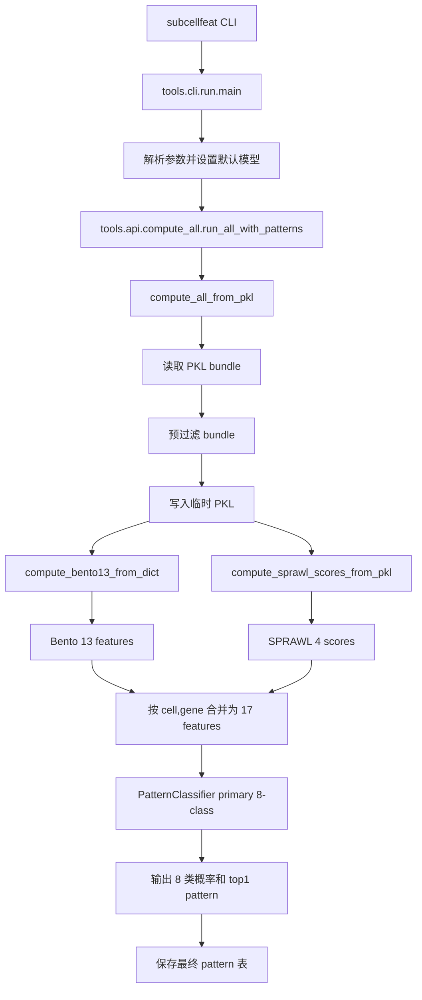
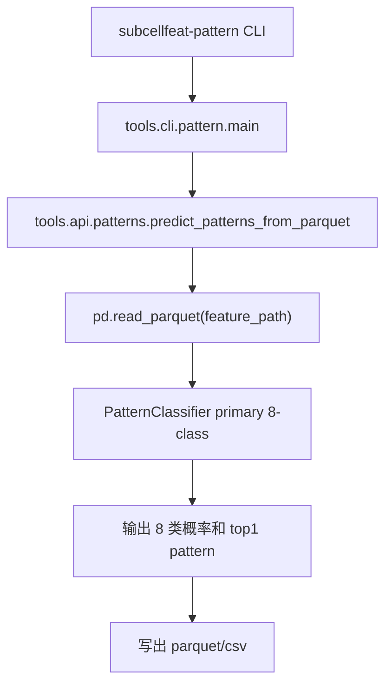

# RNA localization pattern 功能完整技术文档

> 文档对象：当前仓库中“RNA 亚细胞定位模式预测”功能的真实实现。
> 仓库根目录：STRAND repository root
> 默认命令：`subcellfeat`
> 单独预测命令：`subcellfeat-pattern`
> 默认主模型：`models/multiclass_xgb_8class_prop075_final_from_cv.joblib`
> 当前默认行为：不再使用 fallback，始终保留 8 类 primary 模型预测结果。

本文只描述当前代码中实际存在并会被默认入口调用的流程。历史 notebook、旧模型和解释性分析会单独标注为“历史路线”或“非默认路线”，不混入当前默认主流程。

---

## 1. 功能总览

定位模式功能的目标是：对每一个 `cell × gene` 样本，根据该基因在该细胞中的 RNA 点坐标、细胞边界、细胞核边界，计算 17 个空间分布特征，然后用训练好的多分类模型输出一个单标签定位模式。

当前默认预测类别是 8 类：

| 类别 | 英文名 | 含义 |
|---|---|---|
| 1 | `Foci` | 点状聚集、局部 foci |
| 2 | `Nuclear` | 核内富集 |
| 3 | `Cytoplasmic` | 细胞质分布 |
| 4 | `Nuclear edge` | 核膜/核边缘富集 |
| 5 | `Cell edge` | 细胞边缘富集 |
| 6 | `Protrusion` | 突起区域富集 |
| 7 | `Radial` | 径向/方向性分布 |
| 8 | `Random` | 随机分布 |

当前最终输出粒度是 `cell × gene`，不是单个 transcript，也不是 gene 的跨细胞汇总。一个 gene 在不同 cell 中可以被预测为不同 pattern。跨数据集、跨条件、跨样本的分析必须在这个 `cell × gene` 结果之上再汇总。

---

## 2. 代码入口与调用链

### 2.1 命令行入口注册

命令注册在 `pyproject.toml`：

```toml
subcellfeat = "tools.cli.run:main"
subcellfeat-pattern = "tools.cli.pattern:main"
```

两个命令的定位模式相关用途不同：

| 命令 | 输入 | 输出 | 是否计算特征 | 是否预测 pattern |
|---|---|---|---|---|
| `subcellfeat` | 原始 PKL bundle | feature 或 pattern 表 | 是 | 默认是 |
| `subcellfeat-pattern` | 已经计算好的 feature parquet | pattern 表 | 否 | 是 |

### 2.2 模块索引

| 模块文件 | 核心对象 | 在定位模式功能中的职责 |
|---|---|---|
| `tools/cli/run.py` | `build_parser`, `main` | `subcellfeat` 命令入口；解析 PKL、输出路径、SPRAWL 参数、预过滤参数和 primary 模型路径 |
| `tools/cli/pattern.py` | `build_parser`, `main` | `subcellfeat-pattern` 命令入口；从已有 feature parquet 直接预测 pattern |
| `tools/api/compute_all.py` | `compute_all_from_pkl` | 从 PKL 计算 Bento13 + SPRAWL4 并合并成 feature 表 |
| `tools/api/compute_all.py` | `run_all_with_patterns` | 从 PKL 一步完成 feature 计算、8 类 primary 预测和结果保存 |
| `tools/api/compute_all.py` | `_prefilter_bundle_before_features` | 在特征计算前执行 nc ratio、cell-gene、gene support 和 cell 同步过滤 |
| `tools/api/patterns.py` | `predict_patterns_from_parquet` | 从已计算 feature parquet 执行 8 类 primary pattern 预测 |
| `tools/models/pattern_classifier.py` | `PatternClassifier` | 加载 joblib bundle、校验特征列、输出概率列和 top1 pattern |
| `tools/io/data_loader.py` | `load_and_process_data` | 读取 PKL，构造 transcript `Point`，把边界转成 shapely `Polygon` |
| `tools/engines/bento_adapter.py` | `compute_bento13_from_dict` | 对每个 `cell × gene` 计算 13 个 Bento/RNAforest 特征 |
| `tools/bento_feature/bento/bento_tools/point_features.py` | `compute_rnaforest13_features` | 封装 Bento proximity、asymmetry、dispersion、Ripley 特征 |
| `tools/bento_feature/bento/bento_tools/shape_features.py` | `compute_cell_prereqs` | 计算 cell radius、raster、span、bounds、area |
| `tools/engines/sprawl_adapter.py` | `compute_sprawl_scores_from_pkl` | 构造 SPRAWL `Cell` 对象并输出 4 个 score 宽表 |
| `tools/sprawl_score/sprawl/scoring.py` | `iter_scores` | 根据 metric 名称分发到对应 SPRAWL 评分函数 |
| `tools/sprawl_score/sprawl/metrics.py` | `peripheral`, `central`, `punctate`, `radial` | 4 个 SPRAWL 空间分布指标的具体定义 |
| `notebooks/XGBoost_8class_proportion075.ipynb` | training cells | 当前 primary 8 类 XGBoost 模型训练 notebook |
| `notebooks/XGBoost_7class.ipynb` | training cells | 历史/备用 7 类 no-Foci XGBoost 模型训练 notebook；当前默认流程不调用 |
| `notebooks/train_pattern_8class.ipynb` | OVR RF cells | 历史 OVR RandomForest 8 类训练 notebook，非默认路线 |

### 2.3 `subcellfeat` 的完整调用链

默认从 PKL 一步跑到 pattern：



### 2.4 `subcellfeat-pattern` 的调用链

这个命令不读取 PKL，也不重新计算 Bento/SPRAWL 特征，只对已有 feature 表预测：



---

## 3. 输入 PKL bundle 标准

当前输入文件是 Python pickle 格式的 bundle。代码期望至少包含以下键：

| key | 是否必需 | 类型 | 用途 |
|---|---|---|---|
| `data_df` | 必需 | `pandas.DataFrame` | transcript 坐标与 gene/cell 信息 |
| `cell_boundary` | 必需 | `dict` | 每个 cell 的细胞边界 |
| `nuclear_boundary` | 可选 | `dict` | 每个 cell 的细胞核边界 |

### 3.1 `data_df` 必需列

| 列名 | 是否必需 | 说明 |
|---|---|---|
| `cell` | 必需 | 细胞 ID。进入流程后统一转为字符串 |
| `gene` | 必需 | 基因名。进入流程后统一转为字符串 |
| `x` | 必需 | transcript 的 x 坐标 |
| `y` | 必需 | transcript 的 y 坐标 |
| `z` | 可选 | 当前定位模式主流程不使用 z；SPRAWL adapter 是单 z-slice 模式 |
| `umi` | 可选 | 当前定位模式主流程不直接使用 |

### 3.2 边界格式

`cell_boundary` 和 `nuclear_boundary` 都允许以下格式：

| 输入类型 | 规则 |
|---|---|
| `DataFrame` | 必须含 `x` 和 `y` 列 |
| `dict` | 必须含 `x` 和 `y` 字段 |
| `ndarray/list` | 必须能转成 `N × 2` 坐标矩阵 |

边界处理规则：

1. 边界点少于 3 个时判为无效。
2. 坐标会转为 `float`。
3. 含 `NaN` 或 `inf` 的点会被删除。
4. 如果首尾未闭合，会自动把第一个点追加到最后，闭合 polygon。
5. 使用 `shapely.geometry.Polygon` 构造多边形。
6. invalid geometry 会先尝试 `buffer(0)` 修复。
7. 如果修复后是 `MultiPolygon`，取面积最大的 `Polygon`。
8. 如果修复后是 `GeometryCollection`，从其中取面积最大的 `Polygon`。
9. 空 polygon、面积小于等于 0 的 polygon、无法修复的 polygon 记为 `None`。
10. `nuclear_boundary` 缺失或为 `None` 时允许继续运行，但所有依赖 nucleus 的 Bento 特征会变成 `NaN`。

---

## 4. 默认 CLI 参数

### 4.1 `subcellfeat` 参数

| 参数 | 默认值 | 是否必需 | 作用 |
|---|---:|---|---|
| `--pkl` | 无 | 是 | 输入 PKL bundle |
| `--out` | 无 | 是 | 输出路径，支持 `.parquet` 或 `.csv` |
| `--fast` | `False` | 否 | 快速调试模式；SPRAWL 只算 `peripheral` 和 `central` |
| `--sprawl-processes` | `max(1, min(8, cpu_count - 1))` | 否 | SPRAWL 多进程数 |
| `--sprawl-iterations` | `200` | 否 | `punctate` 和 `radial` 的 permutation 次数 |
| `--sprawl-pairs` | `4` | 否 | `punctate` 和 `radial` 每次抽样的 pair 数 |
| `--profile` | `False` | 否 | 打印耗时与预过滤统计 |
| `--max-cells` | `None` | 否 | 只保留前 N 个 cell，用于 smoke test |
| `--pattern-model` | `models/multiclass_xgb_8class_prop075_final_from_cv.joblib` | 否 | primary 8 类模型路径 |
| `--fallback-pattern-model` | `None` | 否 | 历史兼容参数；当前 CLI 默认不启用 fallback |
| `--foci-fallback-threshold` | `0.5` | 否 | 历史兼容参数；当前 CLI 不按 Foci 占比自动切换模型 |
| `--no-foci-fallback` | `False` | 否 | 历史兼容参数；当前 CLI 已默认关闭 fallback |
| `--features-only` | `False` | 否 | 只输出 17 维特征，不预测 pattern |
| `--no-prefilter` | `False` | 否 | 关闭默认预过滤 |
| `--nc-ratio-q-low` | `0.025` | 否 | nuclear/cell area ratio 的下分位过滤阈值 |
| `--nc-ratio-q-high` | `0.975` | 否 | nuclear/cell area ratio 的上分位过滤阈值 |
| `--nc-ratio-mean-low` | `0.4` | 否 | nc ratio 过滤后目标均值下限，只用于报告 |
| `--nc-ratio-mean-high` | `0.6` | 否 | nc ratio 过滤后目标均值上限，只用于报告 |
| `--cellgene-filter-min-transcripts` | `6` | 否 | 每个 `cell × gene` 至少保留的 transcript 数 |
| `--gene-filter-min-cells` | `10` | 否 | 每个 gene 至少出现在多少个 cell 中 |

### 4.2 `subcellfeat-pattern` 参数

| 参数 | 默认值 | 是否必需 | 作用 |
|---|---:|---|---|
| `--input` | 无 | 是 | 已计算好的 feature parquet |
| `--output` | 无 | 是 | 输出路径，支持 `.parquet` 或 `.csv` |
| `--model` | `models/multiclass_xgb_8class_prop075_final_from_cv.joblib` | 否 | primary 8 类模型路径 |
| `--fallback-model` | `None` | 否 | 历史兼容参数；当前 CLI 默认不启用 fallback |
| `--foci-fallback-threshold` | `0.5` | 否 | 历史兼容参数；当前 CLI 不按 Foci 占比自动切换模型 |
| `--no-foci-fallback` | `False` | 否 | 历史兼容参数；当前 CLI 已默认关闭 fallback |
| `--profile` | `False` | 否 | 打印 primary pattern 分布 |

### 4.3 API 函数参数：`compute_all_from_pkl`

位置：`tools.api.compute_all.compute_all_from_pkl`

| 参数 | 默认值 | 作用 |
|---|---:|---|
| `pkl_path` | 无 | 输入 PKL bundle 路径 |
| `bento_kwargs` | `None` | 传给 `compute_bento13_from_dict` 的参数字典 |
| `sprawl_kwargs` | `None` | 传给 `compute_sprawl_scores_from_pkl` 的参数字典 |
| `out_path` | `None` | feature 表输出路径；为空则只返回 DataFrame |
| `how` | `"outer"` | Bento 和 SPRAWL 按 `(cell,gene)` join 的方式 |
| `profile` | `False` | 是否启用耗时统计和预过滤日志 |
| `max_cells` | `None` | 只保留前 N 个 cell，用于 smoke test |
| `prefilter_kwargs` | `None` | 传给 `_prefilter_bundle_before_features` 的预过滤参数 |

函数内部固定步骤：

1. 读取原始 PKL。
2. 如果 `prefilter_kwargs` 非空，执行预过滤。
3. 如果 `max_cells` 非空，截取前 N 个 cell。
4. 把处理后的 bundle 写入临时 PKL。
5. 使用临时 PKL 计算 Bento13。
6. 使用同一个临时 PKL 计算 SPRAWL。
7. 标准化两个结果的 `(cell,gene)` index。
8. 按 `how` 合并。
9. 如果 `out_path` 非空，保存为 parquet/csv。
10. 删除临时 PKL。

### 4.4 API 函数参数：`run_all_with_patterns`

位置：`tools.api.compute_all.run_all_with_patterns`

| 参数 | 默认值 | 作用 |
|---|---:|---|
| `pkl_path` | 无 | 输入 PKL bundle 路径 |
| `model_path` | 无 | primary 模型路径 |
| `bento_kwargs` | `None` | Bento 参数字典 |
| `sprawl_kwargs` | `None` | SPRAWL 参数字典 |
| `feature_output_path` | `None` | 可选保存中间 17 维 feature 表 |
| `pattern_output_path` | `None` | 可选保存最终 pattern 表 |
| `how` | `"outer"` | Bento/SPRAWL 合并方式 |
| `profile` | `False` | 是否打印耗时和 primary 分布 |
| `max_cells` | `None` | smoke test 截取 cell 数 |
| `prefilter_kwargs` | `None` | 预过滤参数 |
| `fallback_model_path` | `None` | 历史兼容参数；只有显式启用旧 fallback 时使用 |
| `foci_fallback_threshold` | `0.5` | 历史兼容参数；当前默认不使用 |
| `enable_foci_fallback` | `False` | 当前默认关闭 fallback |

函数内部固定步骤：

1. 调 `compute_all_from_pkl` 得到 feature 表。
2. 如设置 `feature_output_path`，保存中间 feature。
3. 加载 primary `PatternClassifier(model_path)`。
4. 对 feature 表执行 8 类预测。
5. 计算 primary `Foci` 占比用于日志检查。
6. 当前默认不触发 fallback，直接保留 8 类 primary 结果。
7. 如设置 `pattern_output_path`，保存最终结果。
8. 返回最终 DataFrame。

### 4.5 API 函数参数：`predict_patterns_from_parquet`

位置：`tools.api.patterns.predict_patterns_from_parquet`

| 参数 | 默认值 | 作用 |
|---|---:|---|
| `feature_path` | 无 | 已计算好的 feature parquet |
| `output_path` | 无 | pattern 输出路径 |
| `model_path` | 无 | primary 模型路径 |
| `fallback_model_path` | `None` | 历史兼容参数；只有显式启用旧 fallback 时使用 |
| `foci_fallback_threshold` | `0.5` | 历史兼容参数；当前默认不使用 |
| `enable_foci_fallback` | `False` | 当前默认关闭 fallback |
| `profile` | `False` | 是否打印 primary 分布 |

这个 API 与 `run_all_with_patterns` 的区别是：它不读 PKL、不预过滤、不计算特征，只读取 feature parquet 并用 8 类 primary 模型预测。

---

## 5. 预过滤流程

预过滤入口是 `tools.api.compute_all._prefilter_bundle_before_features`。默认 `subcellfeat` 会开启预过滤，除非使用 `--no-prefilter`。

预过滤顺序固定为：

1. `nc ratio` 细胞过滤。
2. `cell × gene` 低 transcript 数过滤。
3. gene 支持细胞数过滤。
4. `data_df`、`cell_boundary`、`nuclear_boundary` 的 cell 同步。

### 5.1 raw stats

进入预过滤前先统计原始 bundle：

| 统计项 | 含义 |
|---|---|
| `n_cells` | `data_df[cell]` 中不同 cell 数 |
| `n_genes` | `data_df[gene]` 中不同 gene 数 |
| `n_cellgenes` | 不同 `(cell,gene)` 数 |
| `n_rows` | transcript 行数 |
| `n_cell_boundary` | cell boundary 数 |
| `n_nuclear_boundary` | nuclear boundary 数 |

这些统计只用于 `--profile` 打印和内部记录，不直接改变数据。

### 5.2 nc ratio 细胞过滤

`nc ratio` 指每个 cell 的核面积与细胞面积之比：

```text
nc_ratio = nuclear_polygon.area / cell_polygon.area
```

执行条件：

1. `filter_cells_by_nc_ratio=True`。
2. `cell_boundary` 和 `nuclear_boundary` 都存在。
3. cell 与 nucleus polygon 都有效。
4. 只保留 `0 < nc_ratio < 1` 的 cell 进入分位数判断。

默认参数：

| 参数 | 默认值 | 含义 |
|---|---:|---|
| `nc_ratio_q_low` | `0.025` | 下分位点 |
| `nc_ratio_q_high` | `0.975` | 上分位点 |
| `nc_ratio_mean_low` | `0.4` | 目标均值下限，只报告 |
| `nc_ratio_mean_high` | `0.6` | 目标均值上限，只报告 |
| `enforce_mean_range` | `False` | 当前不强制把均值调进目标区间 |

过滤逻辑：

1. 对所有有效 cell 计算 `nc_ratio`。
2. 计算 `q_low_value = quantile(nc_ratio, nc_ratio_q_low)`。
3. 计算 `q_high_value = quantile(nc_ratio, nc_ratio_q_high)`。
4. 保留 `q_low_value <= nc_ratio <= q_high_value` 的 cell。
5. 如果过滤后剩余 cell 太少，代码会跳过该过滤，避免把数据清空。
6. 过滤后均值如果不在 `[0.4, 0.6]`，当前只标记警告，不再继续硬删 cell。

### 5.3 `cell × gene` transcript 数过滤

默认参数：

```text
cellgene_filter_min_transcripts = 6
```

过滤逻辑：

1. 以 `(cell, gene)` 分组统计 transcript 行数。
2. 得到 `n_transcripts`。
3. 只保留 `n_transcripts >= 6` 的 `(cell,gene)`。
4. `data_df` 中不满足条件的 transcript 行全部删除。

这一步非常重要，因为后续 Bento 和 SPRAWL 都是在 `cell × gene` 点集上计算空间特征。点太少时，空间模式本身不稳定，Ripley、punctate、radial 等特征也容易缺失或随机波动。

### 5.4 gene 支持细胞数过滤

默认参数：

```text
gene_filter_min_cells = 10
```

过滤逻辑：

1. 在 `cell × gene` transcript 数过滤之后重新统计每个 gene 出现于多少个 cell。
2. 得到 `n_cells_after_cellgene_filter`。
3. 只保留 `n_cells_after_cellgene_filter >= 10` 的 gene。
4. 删除低支持 gene 的所有 transcript 行。

注意：这一步是 gene 层面的过滤，但删除的是 `data_df` 的 transcript 行。它不会单独生成 gene 汇总模式。

### 5.5 cell 同步

最后对 `data_df`、`cell_boundary`、`nuclear_boundary` 做 cell 交集同步：

1. `data_df` 只保留同步后的 cell。
2. `cell_boundary` 只保留同步后的 cell。
3. 如果存在 `nuclear_boundary`，也只保留同步后的 cell。
4. 如果 `nuclear_boundary` 缺失，只同步 `data_df` 和 `cell_boundary`。

同步的目的不是过滤生物学信号，而是防止某些 cell 有 transcript 但无边界，或有边界但无 transcript，导致下游特征矩阵错位。

---

## 6. Bento 13 个特征

Bento 特征入口是 `tools.engines.bento_adapter.compute_bento13_from_dict`。

### 6.1 Bento adapter 参数

| 参数 | 默认值 | 作用 |
|---|---:|---|
| `pkl_file_path` | 无 | 输入 PKL 文件路径 |
| `cell_id_col` | `cell` | cell ID 列 |
| `gene_col` | `gene` | gene 列 |
| `x_col` | `x` | x 坐标列 |
| `y_col` | `y` | y 坐标列 |
| `instance_key` | `cell` | Bento 内部表示细胞形状的 key |
| `nucleus_key` | `nucleus` | Bento 内部表示细胞核形状的 key |
| `raster_step` | `1` | cell polygon raster 化步长 |
| `profile` | `False` | 是否打印耗时与跳过统计 |
| `max_genes_per_cell` | `None` | 调试参数；每个 cell 只算 spot 数最多的前 N 个 gene |
| `max_spots_per_gene` | `None` | 调试参数；每个 cell-gene 最多使用前 N 个 spot |

### 6.2 Bento adapter 单 cell 处理逻辑

对每个 cell 执行：

1. 从 `data_df` 按 `cell` 分组。
2. 用字符串形式的 cell ID 查找 `cell_boundary_dict`。
3. 如果 cell boundary 缺失，跳过该 cell。
4. 对 cell polygon 再做一次 `_to_single_polygon` 清洗。
5. 对 nucleus polygon 也做 `_to_single_polygon` 清洗；nucleus 缺失允许继续。
6. 如果 nucleus 有效，构造 `shapely.prepared.prep(nuc_poly)`，用于快速判断点是否在核内。
7. 每个 cell 只计算一次 `compute_cell_prereqs(cell_poly, step=raster_step)`，并缓存。
8. 在 cell 内按 gene 分组。
9. 每个 `(cell,gene)` 生成一个 GeoDataFrame。
10. 调用 `compute_rnaforest13_features` 计算 13 个特征。
11. 输出 index 为 `(cell,gene)` 的 Bento 特征表。

### 6.3 cell prereqs

`compute_cell_prereqs` 生成 Bento feature class 需要的 cell-level 字段：

| 字段 | 含义 |
|---|---|
| `radius` | cell polygon 半径，用于距离归一化 |
| `raster` | cell polygon 内部 raster 点阵，用于 dispersion 归一化 |
| `span` | cell polygon 边界点之间最大距离的整数值 |
| `minx` | cell bounding box 最小 x |
| `miny` | cell bounding box 最小 y |
| `maxx` | cell bounding box 最大 x |
| `maxy` | cell bounding box 最大 y |
| `area` | cell polygon 面积 |

### 6.4 单个 `cell × gene` 的 Bento 输入表

每个 `(cell,gene)` 进入 `compute_rnaforest13_features` 前会构造如下字段：

| 字段 | 内容 |
|---|---|
| `x` | RNA 点 x 坐标 |
| `y` | RNA 点 y 坐标 |
| `geometry` | shapely `Point(x,y)` |
| `cell` | cell polygon |
| `nucleus` | nucleus polygon；可为 `None` |
| `nucleus_index` | 点在 nucleus 内则为 `"1"`，否则为 `""` |
| `cell_radius` | cell 半径 |
| `cell_raster` | cell raster 点阵 |
| `cell_span` | cell span |
| `cell_minx` | cell bounding box min x |
| `cell_miny` | cell bounding box min y |
| `cell_maxx` | cell bounding box max x |
| `cell_maxy` | cell bounding box max y |
| `cell_area` | cell 面积 |

### 6.5 13 个 Bento 特征定义

最终保留 13 个 Bento/RNAforest 特征，并统一添加 `bento_` 前缀：

| 输出列 | 来源方法 | 计算逻辑 | 数值解释 |
|---|---|---|---|
| `bento_cell_inner_proximity` | `ShapeProximity(cell, cell)` | cell 内所有 RNA 点到 cell boundary 的平均距离，按 cell radius 转成 proximity | 越接近 1 表示越靠近细胞边界；越接近 0 表示越远离边界 |
| `bento_nucleus_inner_proximity` | `ShapeProximity(cell, nucleus)` | 核内 RNA 点到 nucleus boundary 的平均距离，按 cell radius 转成 proximity | 核内点越靠近核边界值越高；无核或无核内点时为 0/NaN 规则后结果 |
| `bento_nucleus_outer_proximity` | `ShapeProximity(cell, nucleus)` | 核外 RNA 点到 nucleus boundary 的平均距离，按 cell radius 转成 proximity | 核外点越靠近核边界值越高 |
| `bento_cell_inner_asymmetry` | `ShapeAsymmetry(cell, cell)` | cell 内 RNA 点到 cell centroid 的平均距离 / cell radius | 越高表示点集越偏离细胞中心 |
| `bento_nucleus_inner_asymmetry` | `ShapeAsymmetry(cell, nucleus)` | 核内 RNA 点到 nucleus centroid 的平均距离 / cell radius | 越高表示核内点越偏离核中心 |
| `bento_nucleus_outer_asymmetry` | `ShapeAsymmetry(cell, nucleus)` | 核外 RNA 点到 nucleus centroid 的平均距离 / cell radius | 越高表示核外点相对核中心越偏 |
| `bento_point_dispersion_norm` | `PointDispersionNorm` | RNA 点相对 RNA 自身 centroid 的 second moment / cell raster 相对同一 centroid 的 second moment | 越高表示 RNA 点集越分散 |
| `bento_nucleus_dispersion_norm` | `ShapeDispersionNorm(nucleus)` | RNA 点相对 nucleus centroid 的 second moment / cell raster 相对 nucleus centroid 的 second moment | 衡量 RNA 相对核中心的归一化分散 |
| `bento_l_max` | `RipleyStats` | Ripley H/L function 在半 cell span 范围内的最大值 | 反映空间聚集强度 |
| `bento_l_max_gradient` | `RipleyStats` | 平滑后的 Ripley 曲线最大梯度 | 反映聚集尺度变化最快的位置 |
| `bento_l_min_gradient` | `RipleyStats` | 平滑后的 Ripley 曲线最小梯度 | 反映曲线下降/减弱趋势 |
| `bento_l_monotony` | `RipleyStats` | radii 与 Ripley stats 的 Spearman 相关 | 反映 Ripley 曲线单调性 |
| `bento_l_half_radius` | `RipleyStats` | radius = `cell_span / 4` 时的 Ripley H 值 | 固定尺度聚集指标 |

### 6.6 Ripley 特征的具体半径设置

`RipleyStats` 中：

```text
quarter_span = cell_span / 4
radii = np.linspace(1, quarter_span * 2, num=int(quarter_span * 2))
```

也就是从半径 1 到 `cell_span / 2` 上计算 Ripley H function。`l_half_radius` 另外在 `quarter_span` 这个固定半径上计算一次。

如果 RNA 点数小于 2，或者 `radii` 为空，5 个 Ripley 特征全部返回 `NaN`。

### 6.7 Bento 跳过规则

以下情况会跳过 cell 或 cell-gene：

| 情况 | 行为 |
|---|---|
| cell boundary 缺失 | 跳过整个 cell |
| cell polygon 无效且无法修复 | 跳过整个 cell |
| `compute_cell_prereqs` 报错 | 跳过整个 cell |
| 单个 cell-gene 点表为空 | 跳过该 cell-gene |
| `compute_rnaforest13_features` 报错 | 跳过该 cell-gene |

---

## 7. SPRAWL 4 个特征

SPRAWL 特征入口是 `tools.engines.sprawl_adapter.compute_sprawl_scores_from_pkl`。

### 7.1 SPRAWL adapter 参数

| 参数 | 默认值 | 作用 |
|---|---:|---|
| `pkl_file_path` | 无 | 输入 PKL 文件路径 |
| `metrics` | `("peripheral","central","punctate","radial")` | 要计算的 SPRAWL 指标 |
| `processes` | `1` | 多进程数；CLI 默认会设置为 CPU 限制后的值 |
| `num_iterations` | `200` | `punctate`/`radial` permutation 次数 |
| `num_pairs` | `4` | `punctate`/`radial` 每次随机抽取的点对数量 |
| `cell_id_col` | `cell` | cell ID 列 |
| `gene_col` | `gene` | gene 列 |
| `x_col` | `x` | x 坐标列 |
| `y_col` | `y` | y 坐标列 |
| `profile` | `False` | 是否打印耗时 |

### 7.2 SPRAWL 输入构造

对每个 cell：

1. 从 PKL 读取 `data_df` 和 `cell_boundary`。
2. 按 `cell` 分组。
3. 从 `cell_boundary` 取该 cell 的边界坐标。
4. 如果边界为空或点数小于 3，跳过该 cell。
5. 读取该 cell 所有 transcript 的 `(x,y)` 坐标。
6. 读取该 cell 所有 transcript 的 gene 标签。
7. 构造 `tools.sprawl_score.sprawl.cells.Cell`：

```python
Cell(
    cell_id=str(cid),
    boundaries={0: bxy},
    spot_coords={0: spot_xy},
    spot_genes={0: spot_genes},
    annotation="NA",
)
```

当前实现是单 z-slice 模式，统一使用 slice `0`，忽略 `z` 列。

### 7.3 `sprawl_peripheral`

方法：`tools.sprawl_score.sprawl.metrics.peripheral`

计算逻辑：

1. 对 cell 内每个 spot 计算到 cell polygon boundary 的距离。
2. 距离越小，说明越靠近细胞边缘。
3. 对所有 spot 的边界距离排序，rank 从 1 开始。
4. 对每个 gene 取该 gene 所有 spot rank 的中位数 `obs_med`。
5. cell 内随机期望中位数为：

```text
exp_med = (cell.n + 1) / 2
```

6. score：

```text
score = (exp_med - obs_med) / (exp_med - 1)
```

解释：

| score | 含义 |
|---:|---|
| 接近 1 | 该 gene 的 spot 更靠近细胞边界 |
| 接近 0 | 接近随机期望 |
| 小于 0 | 比随机期望更远离边界 |

当前 CLI 对 `peripheral` 设置 `compute_variance=False`，因此不会计算组合理论方差，`variance` 为 `NaN`，最终宽表只保留 `score`。

### 7.4 `sprawl_central`

方法：`tools.sprawl_score.sprawl.metrics.central`

计算逻辑：

1. 对 cell 内每个 spot 计算到 cell 边界坐标均值形成的 centroid 的平方距离。
2. 距离越小，说明越靠近细胞中心。
3. 对所有 spot 的中心距离排序，rank 从 1 开始。
4. 对每个 gene 取该 gene 所有 spot rank 的中位数 `obs_med`。
5. 使用同样公式：

```text
score = (exp_med - obs_med) / (exp_med - 1)
```

解释：

| score | 含义 |
|---:|---|
| 接近 1 | 该 gene 的 spot 更靠近细胞中心 |
| 接近 0 | 接近随机期望 |
| 小于 0 | 比随机期望更远离中心 |

### 7.5 `sprawl_punctate`

方法：`tools.sprawl_score.sprawl.metrics.punctate`

计算逻辑：

1. 先过滤掉 spot 数小于 2 的 gene。
2. 对每个 gene，随机抽取 `num_pairs` 个点对，计算点对欧氏距离的平均值，记为 `obs_dist`。
3. 对同一 spot count 做 `num_iterations` 次 null permutation：
   - 从 cell 的所有 spot 中随机抽取同样数量的 spot。
   - 计算这些随机 spot 的平均点对距离。
   - 形成 `null_dists`。
4. 计算 `obs = sum(null_dists < obs_dist)`。
5. `exp = len(null_dists) / 2`。
6. score：

```text
score = (exp - obs) / exp
```

解释：

| score | 含义 |
|---:|---|
| 接近 1 | 真实 gene spots 比大多数 null 更聚集，呈 punctate/foci 倾向 |
| 接近 0 | 接近随机 |
| 接近 -1 | 真实 gene spots 比 null 更分散 |

默认：

```text
num_iterations = 200
num_pairs = 4
```

### 7.6 `sprawl_radial`

方法：`tools.sprawl_score.sprawl.metrics.radial`

计算逻辑：

1. 先过滤掉 spot 数小于 2 的 gene。
2. cell centroid 使用所有边界坐标均值。
3. 对每个 gene，随机抽取 `num_pairs` 个点对。
4. 对每个点对计算相对于 cell centroid 的夹角。
5. 得到真实 gene 的平均角度距离 `obs_dist`。
6. 对同一 spot count 做 `num_iterations` 次 null permutation。
7. 计算 `obs = sum(null_dists < obs_dist)`。
8. score：

```text
score = (exp - obs) / exp
```

解释：

| score | 含义 |
|---:|---|
| 接近 1 | gene spots 更集中在相似径向方向上 |
| 接近 0 | 接近随机 |
| 接近 -1 | 比 null 更不呈径向集中 |

### 7.7 `--fast` 对 SPRAWL 的影响

如果 `subcellfeat --fast`：

```text
metrics = ("peripheral", "central")
```

这时输出只有 13 个 Bento 特征 + 2 个 SPRAWL 特征，不是完整 17 维特征。默认模型需要 17 个特征，因此 `--fast` 更适合与 `--features-only` 或调试一起使用；如果直接预测，缺少 `sprawl_punctate` 和 `sprawl_radial` 会导致 `PatternClassifier` 报缺失特征列错误。

---

## 8. 17 维特征矩阵合并

入口：`tools.api.compute_all.compute_all_from_pkl`

### 8.1 合并逻辑

1. Bento 输出 index 为 `(cell,gene)`。
2. SPRAWL 输出 index 为 `(cell,gene)`。
3. 两个 index 都经过 `_normalize_index` 统一 cell/gene 字符串格式。
4. 使用：

```python
all_df = bento_df.join(sprawl_df, how=how)
```

默认：

```text
how = "outer"
```

因此只要某个 `(cell,gene)` 在 Bento 或 SPRAWL 任一侧存在，就会出现在合并结果中；另一侧缺失的特征为 `NaN`。

### 8.2 完整 17 个模型特征列

当前两个 XGBoost 模型使用同一套 17 个特征：

```text
bento_cell_inner_proximity
bento_nucleus_inner_proximity
bento_nucleus_outer_proximity
bento_cell_inner_asymmetry
bento_nucleus_inner_asymmetry
bento_nucleus_outer_asymmetry
bento_point_dispersion_norm
bento_nucleus_dispersion_norm
bento_l_max
bento_l_max_gradient
bento_l_min_gradient
bento_l_monotony
bento_l_half_radius
sprawl_peripheral
sprawl_central
sprawl_punctate
sprawl_radial
```

---

## 9. 分类器训练之前的数据构建

当前 primary 8 类主模型基于模拟数据训练。历史/备用 7 类 no-Foci 模型也基于同一批模拟数据构建，但当前默认流程不调用它。训练数据来源：

| 文件 | 内容 |
|---|---|
| `data/simulated_data_dict.pkl` | 模拟 transcript 级数据，含 `groundtruth` 和 `proportion_pattern` |
| `data/simulated_features.parquet` | 对模拟数据预先计算好的 17 维特征 |

当前仓库中保留了训练 notebook 和模拟数据文件，但没有从零生成 `simulated_data_dict.pkl` 的完整脚本。因此，本文能准确说明“训练数据如何从已有模拟数据构建成模型输入”，但不把模拟点位生成算法写成已确认事实。

### 9.1 已确认的模拟数据规模

当前 `data/simulated_data_dict.pkl` 中：

| 项目 | 数量 |
|---|---:|
| transcript 行数 | 1,347,881 |
| 列数 | 12 |
| cell 数 | 50 |
| gene 数 | 400 |
| `cell × gene` 数 | 20,000 |

`data_df` 列：

```text
x, y, cell, gene, batch, proportion_pattern, groundtruth, umi, type, centerX, centerY, sc_total
```

transcript 级 `groundtruth` 计数：

| 类别 | transcript 数 |
|---|---:|
| `Random` | 187,500 |
| `Nuclear` | 187,500 |
| `Nuclear edge` | 187,500 |
| `Cell edge` | 187,500 |
| `Protrusion` | 187,500 |
| `Radial` | 187,500 |
| `Cytoplasmic` | 118,379 |
| `Foci` | 104,502 |

### 9.2 `cell × gene` 标签构建

训练不是 transcript 级训练，而是 `cell × gene` 级训练。构建方式：

1. 读取 `simulated_data_dict.pkl` 的 `data_df`。
2. 读取 `simulated_features.parquet`。
3. `cell`、`gene` 全部转字符串并 strip。
4. `groundtruth` 转字符串并 strip。
5. `proportion_pattern` 转数值。
6. 对 `data_df` 按 `(cell,gene)` 分组。
7. `y_true` 取该组 transcript 中 `groundtruth` 出现次数最多的类别。
8. `proportion_pattern` 取该组均值。
9. `n_transcripts` 取该组 transcript 行数。
10. 得到 cell-gene 级标签表。

未经过强模式筛选前，20,000 个 `cell × gene` 在 8 类中均衡分布：

| 类别 | `cell × gene` 数 |
|---|---:|
| `Foci` | 2,500 |
| `Nuclear` | 2,500 |
| `Cytoplasmic` | 2,500 |
| `Nuclear edge` | 2,500 |
| `Cell edge` | 2,500 |
| `Protrusion` | 2,500 |
| `Radial` | 2,500 |
| `Random` | 2,500 |

`simulated_features.parquet` 的规模：

| 项目 | 数量 |
|---|---:|
| 行数 | 20,000 |
| 列数 | 19 |
| 非特征列 | `cell`, `gene` |
| 特征列 | 17 个 Bento/SPRAWL 特征 |

### 9.3 机器学习样本、特征矩阵与标签的数学定义

定位模式分类器的一个训练样本不是单个 RNA 点，而是一个 `cell × gene` 点集。对第 `i` 个样本：

```text
i = (cell_i, gene_i)
```

该样本对应的原始点集是：

```text
R_i = {(x_ij, y_ij) | j = 1, ..., n_i}
```

其中：

| 符号 | 含义 |
|---|---|
| `R_i` | 第 `i` 个 `cell × gene` 的所有 RNA transcript 坐标集合 |
| `n_i` | 第 `i` 个 `cell × gene` 的 transcript 数 |
| `cell_i` | 该样本所属细胞 |
| `gene_i` | 该样本所属基因 |

特征工程把 `R_i`、细胞边界 `C_i` 和细胞核边界 `N_i` 映射成 17 维向量：

```text
x_i = φ(R_i, C_i, N_i) ∈ R^17
```

训练集矩阵：

```text
X = [x_1; x_2; ...; x_m] ∈ R^(m × 17)
```

标签：

```text
y_i ∈ {0,1,2,3,4,5,6,7}
```

对应类别顺序：

```text
0=Foci
1=Nuclear
2=Cytoplasmic
3=Nuclear edge
4=Cell edge
5=Protrusion
6=Radial
7=Random
```

主模型训练时：

```text
m = 12,000
d = 17
K = 8
X ∈ R^(12000 × 17)
y ∈ {0,...,7}^12000
```

### 9.4 transcript 标签到 `cell × gene` 标签的聚合公式

模拟数据原始标签是 transcript 级 `groundtruth`。对一个 `cell × gene` 样本 `i`，其 transcript 级标签集合为：

```text
G_i = {g_ij | j = 1, ..., n_i}
```

cell-gene 级训练标签定义为众数：

```text
y_i = mode(G_i)
```

代码实现：

```python
y_true=("groundtruth", lambda s: s.value_counts().idxmax())
```

`proportion_pattern` 的 cell-gene 级值定义为 transcript 内均值：

```text
q_i = mean(proportion_pattern_ij)
```

主模型训练只保留：

```text
q_i >= 0.75
```

因此主模型实际学习的是“强模式样本”的分类边界，而不是所有弱混合模式样本的分类边界。

### 9.5 17 维特征向量的计算分块

17 维特征可以拆成两个 block：

```text
x_i = [b_i, s_i]
```

其中：

| block | 维度 | 来源 | 主要表达的信息 |
|---|---:|---|---|
| `b_i` | 13 | Bento/RNAforest | 到细胞边界、核边界、中心、Ripley 聚集尺度 |
| `s_i` | 4 | SPRAWL | 边缘性、中心性、点状聚集、径向方向性 |

更具体地：

```text
b_i ∈ R^13
s_i ∈ R^4
x_i ∈ R^17
```

这 17 维特征不是神经网络自动学习出来的 embedding，而是人工定义的空间统计量。因此模型的作用是学习这些统计量到 8 类定位模式之间的非线性决策边界。

### 9.6 重要特征的计算公式

#### 9.6.1 Proximity 类特征

对某个 shape boundary，代码先计算 RNA 点到 boundary 的平均距离：

```text
d_inner = mean(distance(point_j, boundary))
```

再用 cell radius 归一化：

```text
proximity = (cell_radius - d_inner) / cell_radius
```

解释：

| 数值 | 含义 |
|---:|---|
| 接近 1 | RNA 点靠近对应 boundary |
| 接近 0 | RNA 点远离对应 boundary |

这个定义用于：

```text
bento_cell_inner_proximity
bento_nucleus_inner_proximity
bento_nucleus_outer_proximity
```

#### 9.6.2 Asymmetry 类特征

对某个 shape centroid，计算 RNA 点到 centroid 的平均距离，并用 cell radius 归一化：

```text
asymmetry = mean(distance(point_j, centroid_shape)) / cell_radius
```

解释：

| 数值 | 含义 |
|---:|---|
| 接近 0 | RNA 点更靠近形状中心，空间上更对称 |
| 更大 | RNA 点更偏离中心，空间上更不对称 |

这个定义用于：

```text
bento_cell_inner_asymmetry
bento_nucleus_inner_asymmetry
bento_nucleus_outer_asymmetry
```

#### 9.6.3 Dispersion 类特征

代码使用 second moment 描述点集分散程度：

```text
M(P, c) = sum(||p_j - c||^2 / |P|)
```

其中 `P` 是点集，`c` 是参考中心。

`bento_point_dispersion_norm`：

```text
RNA 点相对 RNA centroid 的 second moment
------------------------------------------------
cell raster 相对 RNA centroid 的 second moment
```

`bento_nucleus_dispersion_norm`：

```text
RNA 点相对 nucleus centroid 的 second moment
------------------------------------------------
cell raster 相对 nucleus centroid 的 second moment
```

解释：

| 数值 | 含义 |
|---:|---|
| 较小 | RNA 点更集中 |
| 较大 | RNA 点更分散 |

#### 9.6.4 Ripley 类特征

`RipleyStats` 对每个 `cell × gene` 的 RNA 点计算 Ripley H function。半径网格：

```text
quarter_span = cell_span / 4
radii = linspace(1, quarter_span * 2, int(quarter_span * 2))
```

然后提取：

| 特征 | 计算 |
|---|---|
| `bento_l_max` | Ripley H 曲线最大值 |
| `bento_l_max_gradient` | rolling mean 后曲线梯度最大值 |
| `bento_l_min_gradient` | rolling mean 后曲线梯度最小值 |
| `bento_l_monotony` | radius 与 Ripley H 值的 Spearman correlation |
| `bento_l_half_radius` | `radius = cell_span / 4` 时的 Ripley H 值 |

如果 RNA 点少于 2 个，Ripley 统计量没有意义，代码返回 `NaN`。

#### 9.6.5 SPRAWL rank score 公式

`sprawl_peripheral` 和 `sprawl_central` 都使用 rank median score：

```text
expected_median_rank = (n_cell_spots + 1) / 2
observed_median_rank = median(rank of gene spots)
score = (expected_median_rank - observed_median_rank) / (expected_median_rank - 1)
```

区别在于 rank 的排序依据：

| 特征 | rank 排序依据 | 高 score 表示 |
|---|---|---|
| `sprawl_peripheral` | spot 到 cell boundary 的距离；越近 rank 越小 | gene 更靠细胞边缘 |
| `sprawl_central` | spot 到 cell centroid 的平方距离；越近 rank 越小 | gene 更靠细胞中心 |

#### 9.6.6 SPRAWL permutation score 公式

`sprawl_punctate` 和 `sprawl_radial` 使用 permutation null：

```text
obs_stat = statistic(gene spots)
null_stat_t = statistic(random spots with same spot count), t = 1,...,T
obs = count(null_stat_t < obs_stat)
exp = T / 2
score = (exp - obs) / exp
```

默认：

```text
T = num_iterations = 200
num_pairs = 4
```

区别在于 statistic：

| 特征 | statistic | 高 score 表示 |
|---|---|---|
| `sprawl_punctate` | 随机点对平均欧氏距离 | gene spots 比随机更聚集 |
| `sprawl_radial` | 随机点对相对 cell centroid 的平均角度距离 | gene spots 更集中在相似径向方向 |

### 9.7 XGBoost 多分类模型的数学形式

当前 primary 模型是 XGBoost multiclass softprob。模型对每个样本 `x_i` 输出 8 个类别的 raw score：

```text
F_k(x_i), k = 1,...,8
```

softmax 概率：

```text
P(y_i = k | x_i) = exp(F_k(x_i)) / sum_l exp(F_l(x_i))
```

最终预测：

```text
pattern_i = argmax_k P(y_i = k | x_i)
```

代码对应：

```python
probs = model.predict_proba(X)
pattern = prob_df.idxmax(axis=1)
```

### 9.8 多分类训练目标函数

XGBoost 的目标函数由多分类 logloss 和树模型正则项组成。对训练集：

```text
L = sum_i -log P(y_i | x_i) + sum_t Ω(f_t)
```

其中树的正则项概念上为：

```text
Ω(f_t) = γT + 1/2 * λ * ||w||_2^2 + α * ||w||_1
```

当前参数中：

```text
reg_alpha = 0.0
reg_lambda = 1.0
eval_metric = mlogloss
```

因此当前训练显式使用 L2 正则，不使用 L1 正则。`eval_metric="mlogloss"` 表示交叉验证和训练日志关注多分类负对数似然。

### 9.9 模型容量参数的含义

| 参数 | 当前值 | 机器学习含义 |
|---|---:|---|
| `n_estimators` | 300 | boosting 轮数；轮数越多模型容量越大 |
| `learning_rate` | 0.05 | 每棵树对总模型的贡献缩放；较小学习率通常更稳 |
| `max_depth` | 6 | 单棵树最大深度；控制非线性和交互项复杂度 |
| `min_child_weight` | 1 | 控制叶子节点最小二阶梯度权重，越大越保守 |
| `subsample` | 0.8 | 每轮采样 80% 样本，降低过拟合 |
| `colsample_bytree` | 0.8 | 每棵树采样 80% 特征，降低特征依赖和过拟合 |
| `reg_alpha` | 0.0 | L1 正则强度 |
| `reg_lambda` | 1.0 | L2 正则强度 |
| `tree_method` | `hist` | 直方图近似分裂，提升训练速度 |

### 9.10 GroupKFold 的防泄漏逻辑

训练评估使用：

```text
GroupKFold(n_splits=5)
group = cell
```

这不是普通 KFold。普通 KFold 可能让同一个 cell 的不同 gene 同时出现在 train 和 test 中，模型可能利用 cell 的几何尺度、边界特征、核形态等 cell-level 信息产生信息泄漏。

GroupKFold 的约束是：

```text
train_cells ∩ test_cells = ∅
```

因此 OOF 指标更接近“模型能否泛化到未见过的 cell”。

当前模拟数据有 50 个 cell，5 折后每折大致：

```text
train cells = 40
test cells = 10
```

### 9.11 OOF 预测与指标定义

OOF 是 out-of-fold prediction。每个样本只在它没有参与训练的 fold 中被预测一次：

```text
OOF_i = model_fold_not_trained_on_i(x_i)
```

最终把 5 个 fold 的 OOF prediction 合并，再计算整体指标。

主要指标：

```text
accuracy = correct predictions / all predictions
```

对每个类别 `k`：

```text
precision_k = TP_k / (TP_k + FP_k)
recall_k    = TP_k / (TP_k + FN_k)
F1_k        = 2 * precision_k * recall_k / (precision_k + recall_k)
```

宏平均：

```text
macro_F1 = mean(F1_k over classes)
```

加权平均：

```text
weighted_F1 = sum_k support_k * F1_k / sum_k support_k
```

当前主模型训练集每类都是 1,500 个样本，因此 macro 和 weighted 指标非常接近。

### 9.12 概率列的机器学习含义

输出中的 `p_<class>` 是模型 softmax 概率：

```text
p_Foci + p_Nuclear + ... + p_Random = 1
```

但它不是“这个 gene 在细胞中有多少比例 RNA 属于该模式”。它表示在 17 维特征输入下，模型把该 `cell × gene` 判成某个类别的相对置信度。

下游做 gene pattern 分布时，应该优先统计离散 `pattern` 的 cell 数，而不是把概率直接解释成生物学比例。

从机器学习角度，单行输出可以这样读：

```text
input:  x_i ∈ R^17
model:  P_i = [p_i,Foci, p_i,Nuclear, ..., p_i,Random]
label:  pattern_i = argmax(P_i)
```

如果某个 gene 在 100 个 cell 中有 60 个 `pattern=Cytoplasmic`、30 个 `pattern=Random`、10 个 `pattern=Nuclear`，这才是该 gene 在该样本中的离散 pattern 分布：

```text
Cytoplasmic: 60 cells
Random:      30 cells
Nuclear:     10 cells
```

而不是把 100 行的 `p_Cytoplasmic` 直接平均后解释为“60% RNA 在细胞质”。平均概率可以作为模型置信度辅助指标，但不能替代离散 pattern 计数。

### 9.13 缺失值与模型处理

当前 primary XGBoost 模型没有显式 imputer。也就是说：

```text
features with NaN -> directly passed into XGBoost
```

XGBoost 对 missing value 有内置默认分裂方向学习机制。因此代码不需要 `SimpleImputer`。但是从生物学解释角度，某个样本如果 nucleus 相关特征大量 `NaN`，说明它的核边界信息不足，对 `Nuclear` 和 `Nuclear edge` 的判断应谨慎。

### 9.14 当前模型没有做的机器学习步骤

当前默认模型没有做：

1. 特征标准化或 z-score。
2. 显式缺失值填补。
3. 概率校准。
4. 类别阈值优化。
5. 多标签输出。
6. 不确定性类别 `Ambiguous`。
7. 逐 dataset fine-tuning。
8. 真实人工标签监督训练。

这意味着当前模型是一个“模拟数据训练的固定 8 类多分类器”，不是一个会根据新数据集自适应更新的模型。

### 9.15 计算复杂度直观拆分

对真实数据运行时，主要耗时不在 XGBoost 预测，而在特征计算。

| 阶段 | 主要复杂度来源 | 直观说明 |
|---|---|---|
| 预过滤 | groupby `(cell,gene)` 和 gene support | 主要随 transcript 行数线性增长 |
| Bento proximity/asymmetry | 点到边界/中心距离 | 随每个 `cell × gene` spot 数增长 |
| Bento raster/dispersion | cell raster 点数 | 大 cell 或小 `raster_step` 会更慢 |
| Bento Ripley | 点对空间统计和多个 radius | spot 数越多越慢；点数小于 2 返回 NaN |
| SPRAWL peripheral/central | 全 cell spot 排序 | 每个 cell 内排序成本较高 |
| SPRAWL punctate/radial | permutation | 与 `num_iterations × num_pairs × gene数 × cell数` 强相关 |
| XGBoost predict | 17 维矩阵前向 | 相对很快 |

当前默认 `num_iterations=200`、`num_pairs=4` 是速度和稳定性的折中。如果显著增大 `num_iterations`，最直接增加的是 `sprawl_punctate` 和 `sprawl_radial` 的耗时。

---

## 10. Primary 8-class XGBoost 模型训练

训练 notebook：`notebooks/XGBoost_8class_proportion075.ipynb`

输出模型：

```text
models/multiclass_xgb_8class_prop075_final_from_cv.joblib
```

### 10.1 训练样本筛选

主模型只使用强模拟模式：

```text
proportion_pattern >= 0.75
```

筛选后训练数据规模：

| 项目 | 数量 |
|---|---:|
| `cell × gene` 样本数 | 12,000 |
| cell 数 | 50 |
| gene 数 | 240 |
| 每类样本数 | 1,500 |

筛选后的类别分布：

| 类别 | 样本数 |
|---|---:|
| `Foci` | 1,500 |
| `Nuclear` | 1,500 |
| `Cytoplasmic` | 1,500 |
| `Nuclear edge` | 1,500 |
| `Cell edge` | 1,500 |
| `Protrusion` | 1,500 |
| `Radial` | 1,500 |
| `Random` | 1,500 |

### 10.2 训练类别顺序

```python
CLASSES = [
    "Foci",
    "Nuclear",
    "Cytoplasmic",
    "Nuclear edge",
    "Cell edge",
    "Protrusion",
    "Radial",
    "Random",
]
```

类别 ID：

```python
CLASS_TO_ID = {c: i for i, c in enumerate(CLASSES)}
```

因此模型 `predict_proba` 的列顺序必须与 `CLASSES` 一致。

### 10.3 特征列选择

主模型 notebook 中：

```python
FEATURE_COLS = [
    c for c in data.columns
    if c not in ("cell", "gene", "y_true")
]
```

在当前训练数据中实际就是 17 个 Bento/SPRAWL 特征。

### 10.4 交叉验证方式

交叉验证：

```python
GroupKFold(n_splits=5)
groups = data["cell"].astype(str).values
```

这意味着同一个 cell 不会同时出现在训练 fold 和测试 fold 中。这个设计避免模型只记住 cell 级几何或尺度特征导致过高估计。

每个 fold：

1. 按 cell 分组切分。
2. 训练集 40 个 cell。
3. 测试集 10 个 cell。
4. 用 `random_state = 42 + fold_id` 初始化模型。
5. `model.fit(X_train, y_train)`。
6. `model.predict_proba(X_test)` 输出 8 类概率。
7. `argmax` 得到 `pattern_top1`。
8. 计算 accuracy、balanced accuracy、macro/weighted precision、recall、F1。
9. 保存 fold confusion matrix。
10. 汇总 OOF 结果。

### 10.5 XGBoost 参数

主模型参数：

| 参数 | 值 |
|---|---:|
| `objective` | `multi:softprob` |
| `num_class` | `8` |
| `n_estimators` | `300` |
| `learning_rate` | `0.05` |
| `max_depth` | `6` |
| `min_child_weight` | `1` |
| `subsample` | `0.8` |
| `colsample_bytree` | `0.8` |
| `reg_alpha` | `0.0` |
| `reg_lambda` | `1.0` |
| `eval_metric` | `mlogloss` |
| `random_state` | final model 为 `42`；CV fold 为 `42 + fold_id` |
| `n_jobs` | `-1` |
| `tree_method` | `hist` |

### 10.6 final model 训练与保存

5 折 OOF 评估完成后，notebook 会用筛选后的全部 12,000 个样本重新训练 final model：

```python
final_model = make_multiclass_xgb(random_state=42)
final_model.fit(X_all, y_all)
```

保存 joblib bundle：

| 字段 | 内容 |
|---|---|
| `model` | 训练好的 `XGBClassifier` |
| `feature_cols` | 17 个特征列 |
| `classes` | 8 个类别名 |
| `class_to_id` | 类别名到整数 ID |
| `id_to_class` | 整数 ID 到类别名 |
| `meta` | 训练说明、模型参数、OOF 指标 |

### 10.7 主模型 OOF 整体指标

| 指标 | 值 |
|---|---:|
| `oof_accuracy` | 0.9566666667 |
| `oof_balanced_accuracy` | 0.9566666667 |
| `macro_precision` | 0.9570584378 |
| `macro_recall` | 0.9566666667 |
| `macro_f1` | 0.9568345070 |
| `weighted_precision` | 0.9570584378 |
| `weighted_recall` | 0.9566666667 |
| `weighted_f1` | 0.9568345070 |

### 10.8 主模型 per-class 指标

| 类别 | precision | recall | F1 | support |
|---|---:|---:|---:|---:|
| `Foci` | 0.959786 | 0.954667 | 0.957219 | 1500 |
| `Nuclear` | 0.995321 | 0.992667 | 0.993992 | 1500 |
| `Cytoplasmic` | 0.880734 | 0.896000 | 0.888301 | 1500 |
| `Nuclear edge` | 0.962416 | 0.956000 | 0.959197 | 1500 |
| `Cell edge` | 0.972757 | 0.976000 | 0.974376 | 1500 |
| `Protrusion` | 0.997284 | 0.979333 | 0.988227 | 1500 |
| `Radial` | 0.988629 | 0.985333 | 0.986978 | 1500 |
| `Random` | 0.899540 | 0.913333 | 0.906384 | 1500 |

---

## 11. 历史/备用 7-class no-Foci XGBoost 模型训练

训练 notebook：`notebooks/XGBoost_7class.ipynb`

输出模型：

```text
models/multiclass_xgb_7class_no_foci_final_from_cv.joblib
```

### 11.1 当前状态

该模型是历史/备用模型。当前默认定位模式流程已经不再使用它，也不会因为 primary 8 类模型预测出较高 `Foci` 占比而自动切换到该模型。

保留该 section 的原因是：它仍然存在于仓库中，且属于定位模式分类器训练历史的一部分。它不代表当前默认预测逻辑。

### 11.2 训练数据构建

7 类 no-Foci 模型训练数据构建方式：

1. 读取 `data/simulated_data_dict.pkl`。
2. 读取 `data/simulated_features.parquet`。
3. `cell`、`gene`、`groundtruth` 转字符串并 strip。
4. 从 transcript 级模拟数据中删除所有 `groundtruth == "Foci"` 的 transcript。
5. 对剩余 transcript 按 `(cell,gene)` 分组。
6. 每个 `(cell,gene)` 使用 `.first()` 取 `groundtruth` 作为 `y_true`。
7. 与 17 维特征表按 `(cell,gene)` inner merge。
8. 只保留 7 个非 Foci 类别。

注意：7 类 no-Foci 训练没有使用 `proportion_pattern >= 0.75` 这条强模式筛选。它的训练说明是“all available labeled data after removing Foci”。

### 11.3 7 类模型类别顺序

```python
CLASSES = [
    "Nuclear",
    "Cytoplasmic",
    "Nuclear edge",
    "Cell edge",
    "Protrusion",
    "Radial",
    "Random",
]
```

### 11.4 7 类模型训练规模

模型 bundle meta 中记录：

| 项目 | 数量 |
|---|---:|
| `n_classes` | 7 |
| `n_samples` | 17,500 |
| `n_cells` | 50 |
| `n_genes` | 350 |
| removed class | `Foci` |

### 11.5 7 类模型 XGBoost 参数

除了 `num_class=7`，其余参数与主模型一致：

| 参数 | 值 |
|---|---:|
| `objective` | `multi:softprob` |
| `num_class` | `7` |
| `n_estimators` | `300` |
| `learning_rate` | `0.05` |
| `max_depth` | `6` |
| `min_child_weight` | `1` |
| `subsample` | `0.8` |
| `colsample_bytree` | `0.8` |
| `reg_alpha` | `0.0` |
| `reg_lambda` | `1.0` |
| `eval_metric` | `mlogloss` |
| `random_state` | final model 为 `42`；CV fold 为 `42 + fold_id` |
| `n_jobs` | `-1` |
| `tree_method` | `hist` |

### 11.6 7 类模型 OOF 指标

| 指标 | 值 |
|---|---:|
| `oof_accuracy` | 0.9274857143 |
| `oof_balanced_accuracy` | 0.9274857143 |
| `macro_precision` | 0.9281157339 |
| `macro_recall` | 0.9274857143 |
| `macro_f1` | 0.9277162624 |
| `weighted_precision` | 0.9281157339 |
| `weighted_recall` | 0.9274857143 |
| `weighted_f1` | 0.9277162624 |

---

## 12. 当前预测器 `PatternClassifier`

预测器实现：`tools.models.pattern_classifier.PatternClassifier`

### 12.1 模型 bundle 格式要求

joblib 文件必须是 dict，至少包含：

| 字段 | 是否必需 | 说明 |
|---|---|---|
| `model` | 必需 | 已训练模型；兼容旧别名 `clf` |
| `feature_cols` | 必需 | 训练时使用的特征列 |
| `classes` | 必需 | 类别名顺序 |
| `meta` | 可选 | 训练元信息 |

如果不是 dict，或缺少 `model`/`feature_cols`/`classes`，会直接抛出 `ValueError`。

### 12.2 输入标准化

`PatternClassifier._normalize_input` 执行：

1. 复制输入 DataFrame。
2. 检查必须含 `cell` 和 `gene` 列。
3. `cell` 转字符串并 strip。
4. `gene` 转字符串并 strip。
5. 检查所有 `feature_cols` 是否存在。
6. 如果缺列，抛出 `ValueError`，列出缺失特征。

### 12.3 概率输出

`predict_proba` 执行：

```python
X = df[self.feature_cols].copy()
probs = self.model.predict_proba(X)
```

检查：

```text
probs.shape[1] == len(self.classes)
```

返回列名为类别名的概率表。

### 12.4 最终 pattern 判定

`infer_labels` 使用：

```python
top1 = prob_df.idxmax(axis=1).tolist()
```

因此当前单个 `cell × gene` 的最终 `pattern` 是最高概率类别。

重要限制：

1. 当前预测阶段没有 tie 检测。
2. 当前预测阶段没有 `Ambiguous` 类。
3. 当前预测阶段没有概率阈值。
4. 当前预测阶段不会输出多标签。
5. 如果两个类别概率完全相同，`pandas.idxmax` 会返回列顺序中第一个最大值。

---

## 13. 当前不使用 fallback 的预测逻辑

当前默认预测逻辑是：对所有输入行只使用 primary 8 类模型，输出 8 类概率列和 top1 `pattern`。不会再因为 `Foci` 占比过高而切换到 7 类 no-Foci 模型。

代码中仍保留 `_get_foci_ratio` 用于日志和兼容旧 API：

```text
foci_ratio = number(pattern == "Foci") / number(all rows)
```

旧 fallback 逻辑的触发条件仍保留在 API 代码里，但默认关闭：

```text
enable_foci_fallback == True
fallback_model_path is not None
foci_ratio > foci_fallback_threshold
```

默认：

```text
enable_foci_fallback = False
foci_fallback_threshold = 0.5  # 历史兼容参数
fallback_model_path = None     # CLI 默认不设置 fallback 模型
```

因此在当前默认 CLI 下：

1. `subcellfeat` 不触发 fallback。
2. `subcellfeat-pattern` 不触发 fallback。
3. 最终输出保留 `p_Foci`。
4. 最终 `pattern` 仍可能是 `Foci`。
5. 结果始终是 8 类模型结果。

只有开发者在 Python API 中显式传入 `enable_foci_fallback=True` 且提供 `fallback_model_path` 时，才会启用旧逻辑。旧逻辑触发后：

1. 不重新计算 Bento/SPRAWL。
2. 使用同一套 17 维 feature。
3. 用 fallback 7 类模型重新 `predict`。
4. 用 fallback 结果整体替换 primary 结果。
5. 最终输出只含 7 类概率列，不含 `p_Foci`。

当前代码中以下 3 个溯源字段被注释掉了，不会出现在输出文件中：

```python
# out_df["pattern_model_used"]
# out_df["primary_foci_ratio"]
# out_df["foci_fallback_threshold"]
```

当前默认新结果应该包含 `p_Foci`。如果某个旧结果文件没有 `p_Foci`，说明它很可能是在旧 fallback 默认启用时期生成的，不能代表当前默认流程。

---

## 14. 输出文件与字段

### 14.1 `--features-only` 输出

如果使用：

```bash
subcellfeat --pkl data/dataset1.pkl --out data/dataset1_features.parquet --features-only
```

输出为 feature 表：

| 字段类型 | 字段 |
|---|---|
| ID | `cell`, `gene` |
| Bento | 13 个 `bento_*` 特征 |
| SPRAWL | 默认 4 个 `sprawl_*` 特征 |

### 14.2 默认 pattern 输出

默认：

```bash
subcellfeat --pkl data/dataset1.pkl --out data/dataset1_pattern.parquet
```

输出字段：

| 字段类型 | 字段 |
|---|---|
| ID | `cell`, `gene` |
| 特征 | 17 个 Bento/SPRAWL 特征 |
| 概率 | `p_<class>` |
| 最终标签 | `pattern` |

如果使用 primary 8 类模型，概率列是：

```text
p_Foci
p_Nuclear
p_Cytoplasmic
p_Nuclear edge
p_Cell edge
p_Protrusion
p_Radial
p_Random
```

当前默认流程不再生成 7 类 fallback 输出。因此新结果应该包含 `p_Foci`；没有 `p_Foci` 的结果应视为旧流程产物或非默认 API 调用产物。

### 14.3 旧 Dataset5 输出例子

`RNApatterns/Dataset5/Dataset5_pattern.parquet` 当前规模：

| 项目 | 数量 |
|---|---:|
| 行数 | 119,109 |
| 列数 | 27 |

该文件列中没有 `p_Foci`，说明它是在旧 fallback 默认启用时期或非默认流程下生成的 7 类输出。当前默认流程如果重新生成，应输出 8 类结果并包含 `p_Foci`。该旧文件 pattern 分布：

| pattern | `cell × gene` 数 |
|---|---:|
| `Radial` | 51,019 |
| `Cytoplasmic` | 38,230 |
| `Nuclear` | 13,035 |
| `Nuclear edge` | 10,382 |
| `Protrusion` | 3,753 |
| `Cell edge` | 2,265 |
| `Random` | 425 |

---

## 15. 当前功能与后续跨数据集分析的关系

定位模式功能只负责输出每个 `cell × gene` 的离散 pattern。它本身不直接回答：

1. 一个 gene 在所有 dataset 中的 pattern 分布。
2. 一个 gene 在不同条件之间从哪类转到哪类。
3. 相同 cell type 换组织后是否转移。
4. 相同疾病状态下不同样本是否一致。
5. Dataset10/Dataset12 这类多样本数据中具体哪些 gene 发生转移。

这些都属于下游分析，必须基于 pattern 输出表再做汇总。正确的下游粒度应区分：

| 分析问题 | 推荐粒度 |
|---|---|
| 单个 gene 在一个样本中的主模式 | `sample × gene` 汇总 |
| 一个 gene 在所有 cell 中的模式分布 | `gene × pattern` 计数和比例 |
| 条件间转移 | `condition_A × gene` vs `condition_B × gene` |
| cell type 换组织环境 | 固定 `cell_type`，比较不同 `tissue` |
| 同一 dataset 多样本比较 | 固定 dataset 内 sample/condition，比较 gene pattern |

不要把未检测到的 gene 当成 `Random`。未检测到是缺失，不是随机定位。

---

## 16. 历史与非默认模型路线

仓库中存在多个模型训练 notebook 和模型文件，但当前默认 CLI 不调用它们。

### 16.1 旧 OVR RandomForest 8-class

notebook：

```text
notebooks/train_pattern_8class.ipynb
```

模型文件：

```text
models/pattern_ovr_8class_final_from_cv.joblib
models/pattern_ovr_8class_final_from_cv_v2.joblib
models/pattern_ovr_8class_full_80_20.joblib
```

逻辑：

1. 使用 `GroupShuffleSplit` 按 cell 做 80/20 train/test。
2. train 内再用 `GroupShuffleSplit` 分出 validation。
3. 每个类别训练一个二分类模型。
4. 二分类模型是：

```text
SimpleImputer(strategy="median")
RandomForestClassifier(n_estimators=400, n_jobs=-1, random_state=..., class_weight=None)
CalibratedClassifierCV(cv=3, method="sigmoid")
```

5. 输出 `pattern_multi` 和 `pattern_top1`。

这条路线是历史路线，不是当前默认 `subcellfeat` 使用的分类器。

### 16.2 其他多分类模型

仓库中还存在 Logistic Regression、RandomForest、ExtraTrees、LightGBM、旧 XGBoost 等模型文件和解释性输出。这些属于模型比较或历史实验，不是当前默认定位模式功能的执行路径。

当前默认路径只使用 8 类 primary 模型：

```text
models/multiclass_xgb_8class_prop075_final_from_cv.joblib
```

`models/multiclass_xgb_7class_no_foci_final_from_cv.joblib` 仍保留在仓库中，但当前默认 CLI 不调用它。

---

## 17. 常用运行命令

### 17.1 从 PKL 直接输出 pattern

```bash
subcellfeat \
  --pkl data/dataset1.pkl \
  --out RNApatterns/Dataset1/Dataset1_pattern.parquet
```

### 17.2 只计算 17 维特征

```bash
subcellfeat \
  --pkl data/dataset1.pkl \
  --out RNApatterns/Dataset1/Dataset1_features.parquet \
  --features-only
```

### 17.3 对已有 feature parquet 预测 pattern

```bash
subcellfeat-pattern \
  --input RNApatterns/Dataset1/Dataset1_features.parquet \
  --output RNApatterns/Dataset1/Dataset1_pattern.parquet
```

### 17.4 当前默认已经关闭 fallback

```bash
subcellfeat \
  --pkl data/dataset1.pkl \
  --out RNApatterns/Dataset1/Dataset1_pattern.parquet
```

当前不需要额外加 `--no-foci-fallback`；该参数只是历史兼容参数。

### 17.5 打印预过滤、耗时和 pattern 分布

```bash
subcellfeat \
  --pkl data/dataset1.pkl \
  --out RNApatterns/Dataset1/Dataset1_pattern.parquet \
  --profile
```

### 17.6 关闭预过滤

```bash
subcellfeat \
  --pkl data/dataset1.pkl \
  --out RNApatterns/Dataset1/Dataset1_pattern_no_prefilter.parquet \
  --no-prefilter
```

---

## 18. 复现与检查清单

运行一个新数据集前检查：

1. PKL 是否包含 `data_df`。
2. `data_df` 是否含 `cell/gene/x/y`。
3. `cell_boundary` 是否存在且 key 能与 `data_df[cell]` 对上。
4. 如果需要核相关特征，`nuclear_boundary` 是否存在。
5. 是否接受默认预过滤：`nc ratio`、`cell-gene >= 6 transcripts`、`gene >= 10 cells`。
6. 新结果是否包含 `p_Foci`；当前默认应包含该列。
7. 是否启用 `--profile` 保存运行日志，用于检查 primary pattern 分布。
8. 输出结果中是否有 `p_Foci`：
   - 有：最终表是 8 类 primary 输出。
   - 无：通常是旧 fallback 结果或非默认 API 调用结果。

模型输入检查：

1. feature 表必须含 `cell`、`gene`。
2. feature 表必须含完整 17 个特征列。
3. `--fast` 输出不完整，不能直接给默认模型预测。
4. 若有大量 `NaN`，XGBoost 可以接收，但生物学解释需要谨慎。

---

## 19. 已知限制

1. 当前模型训练基于模拟数据，不是人工标注真实图像训练集。
2. 当前仓库没有保留从零生成 `simulated_data_dict.pkl` 的完整脚本，因此模拟点位生成算法不能从代码完全复原。
3. 默认预测是单标签 top1，不是多标签。
4. 默认预测不输出 `Ambiguous`。
5. 默认预测不保存 `pattern_model_used`、`primary_foci_ratio`、`foci_fallback_threshold`。
6. 当前默认不再使用 7 类 no-Foci fallback，因此真实数据中 `Foci` 会被完整保留为一个可分析类别。
7. `nuclear_boundary` 缺失时核相关 Bento 特征会变成 `NaN`，这会影响 `Nuclear`、`Nuclear edge` 等模式判断。
8. SPRAWL 当前 adapter 忽略 z 轴，是 2D 单 slice 处理。
9. 下游跨数据集分析必须基于 `cell × gene` 输出再做统计，不能直接把单个 row 当成 gene 的全局结论。

---

## 20. 当前默认流程的最短事实总结

当前定位模式功能的真实逻辑是：

1. 从 PKL 读取 transcript 坐标、cell boundary、nucleus boundary。
2. 默认先做预过滤：去掉 nc ratio 极端 cell、低 transcript 的 `cell × gene`、低 cell 支持的 gene，并同步 cell。
3. 对每个 `cell × gene` 计算 13 个 Bento 特征。
4. 对每个 `cell × gene` 计算 4 个 SPRAWL score。
5. 合并成 17 维 feature。
6. 用 8 类 XGBoost primary 模型输出 8 类概率和 top1 `pattern`。
7. 不再执行 Foci fallback；`Foci` 结果会保留在输出中。
8. 最终输出每个 `cell × gene` 的 17 个特征、8 类概率和离散 `pattern`。
